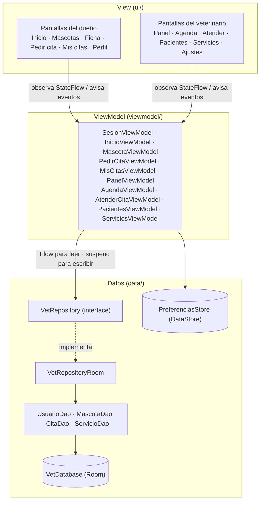
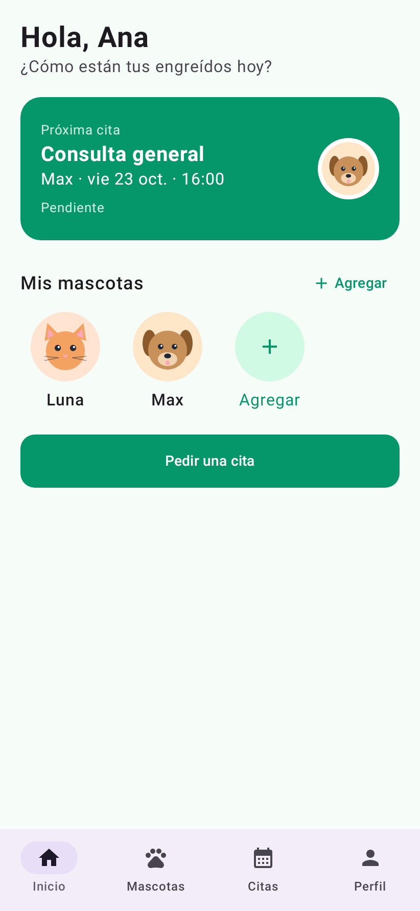
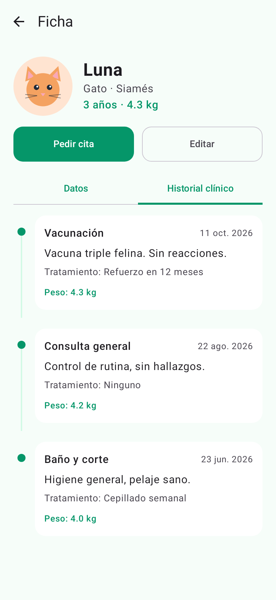
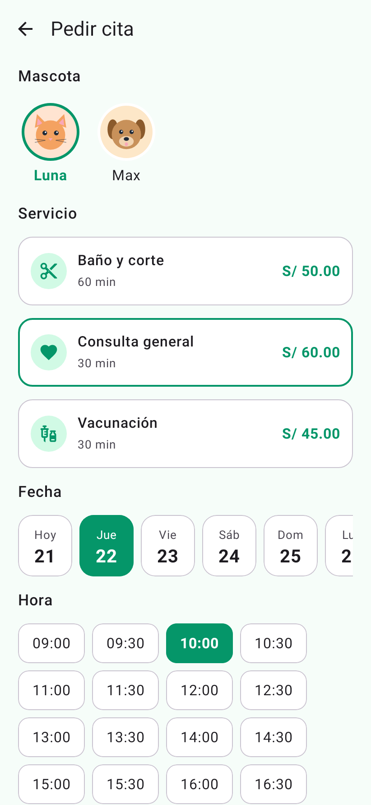
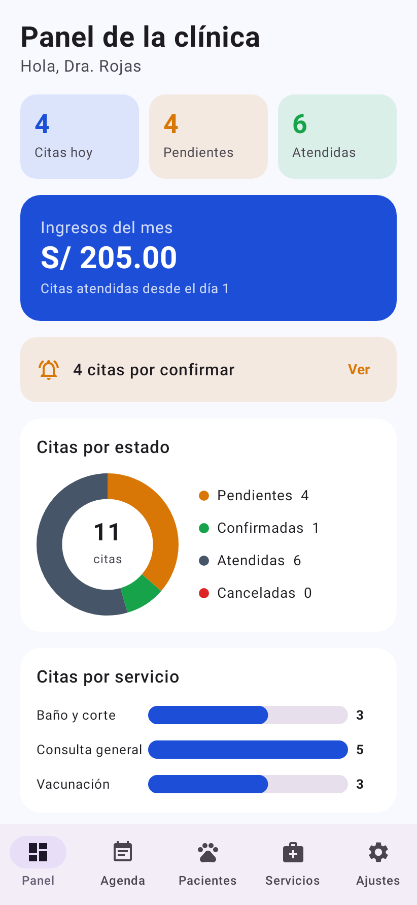
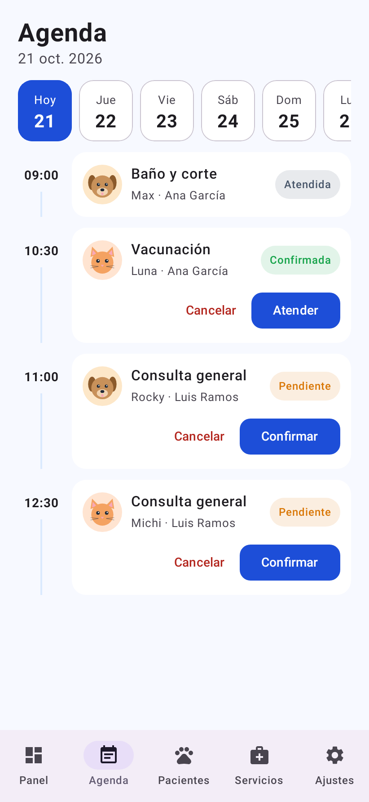
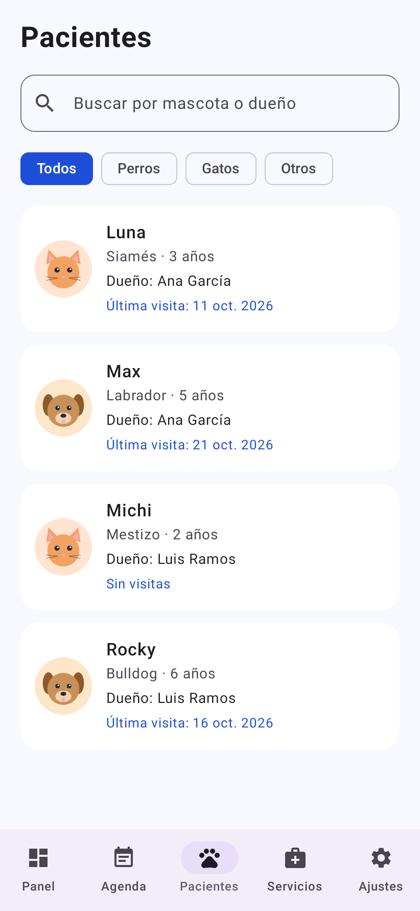

# HuellitasVet

App Android para gestionar una veterinaria con dos perfiles en el mismo dispositivo. El **dueño** registra a sus mascotas, pide citas eligiendo servicio, fecha y hora, y consulta el historial clínico de cada mascota. El **veterinario** ve el panel de la clínica, maneja la agenda del día, registra la atención de cada cita (diagnóstico, tratamiento y peso), consulta a los pacientes y administra los servicios. Ambos perfiles comparten la misma base de datos Room: cuando el veterinario registra una atención, el dueño la ve al instante en el historial de su mascota.

Laboratorio de la semana 8 — Programación en Móviles (Tecsup) · Erick Gamarra

## Tecnologías

| Tema | Uso |
|---|---|
| Lenguaje y UI | Kotlin, Jetpack Compose y Material 3 (sin XML) |
| Arquitectura | MVVM + Repository (interface `VetRepository`) |
| Base de datos | Room: 4 tablas, relaciones anidadas, `@Transaction`, JOIN, GROUP BY y SUM |
| Preferencias | DataStore: perfil activo, modo oscuro, notificaciones y aceptar citas |
| Navegación | Navigation Compose con un grafo por perfil y barra inferior |
| Fechas | `java.time` (`LocalDate`, `LocalTime`, `Duration`), minSdk 26 |
| Gráficos | Canvas: avatar de mascota, gráfico de dona y gráfico de barras |

## Cómo probarla

1. Abre la carpeta `Semana08` en Android Studio y sincroniza Gradle.
2. Ejecuta la app. La primera vez se cargan los datos de ejemplo (servicios, usuarios, mascotas y unas 10 citas).
3. Ingresa con alguno de estos usuarios:

| Perfil | Correo | Clave |
|---|---|---|
| Dueño | `ana@correo.test` | `1234` |
| Dueño | `luis@correo.test` | `1234` |
| Veterinario | `vet@huellitas.test` | `admin` |

## Arquitectura MVVM



| Capa | Conoce a | No debe |
|---|---|---|
| View (`ui/`) | Solo a su ViewModel | Usar DAO, Repository ni reglas de negocio |
| ViewModel | Solo al Repository (interface) | Conocer Composables ni el DAO |
| Repository | Los DAOs | Conocer pantallas ni ViewModels |
| DAO / Room | SQL y entidades | Conocer ViewModels |

Las lecturas que deben actualizar la pantalla devuelven `Flow` y el ViewModel las convierte en `StateFlow` con `stateIn`; las escrituras y acciones únicas son `suspend`. Las reglas de negocio (validaciones, horarios, cancelación, estados de la cita) viven en los ViewModels.

## Reglas de negocio implementadas

- El dueño solo ve sus mascotas y las citas de sus mascotas; el veterinario ve todo.
- Registrar mascota: nombre de al menos 2 caracteres, especie y sexo elegidos, año entre 1990 y el actual y peso mayor que 0. Una mascota con citas no se puede eliminar.
- Pedir cita: servicio activo, fecha de hoy a 7 días y 18 horarios de 09:00 a 17:30. Un horario ocupado (cita no cancelada) o ya pasado aparece gris y tachado. Antes de crear la cita se vuelve a revisar que el horario siga libre.
- Cancelar (dueño): solo citas pendientes o confirmadas y con más de 2 horas de anticipación.
- Estados (veterinario): PENDIENTE → CONFIRMADA; se puede cancelar desde pendiente o confirmada; ATENDIDA solo registrando la atención.
- Registrar atención: diagnóstico de al menos 5 caracteres y peso mayor que 0. En una sola transacción (`withTransaction`) la cita pasa a ATENDIDA y se actualiza el peso de la mascota.
- Panel: citas de hoy, pendientes, atendidas, ingresos del mes (suma de las citas atendidas desde el día 1) y alerta de citas por confirmar.
- Servicios: uno con citas no se puede eliminar, solo desactivar; un servicio inactivo no aparece al pedir cita. Si la clínica no acepta citas, el dueño ve el aviso y no puede pedir una.
- Modo oscuro y perfil activo se guardan en DataStore y se conservan al cerrar la app.

## Estructura de paquetes

```
com.gamarra.huellitasvet
├── data
│   ├── local
│   │   ├── dao
│   │   │   ├── CitaDao.kt
│   │   │   ├── MascotaDao.kt
│   │   │   ├── ServicioDao.kt
│   │   │   └── UsuarioDao.kt
│   │   ├── entity
│   │   │   ├── Cita.kt
│   │   │   ├── Mascota.kt
│   │   │   ├── Servicio.kt
│   │   │   └── Usuario.kt
│   │   ├── relation
│   │   │   ├── CitaConDetalle.kt
│   │   │   └── MascotaConDueno.kt
│   │   ├── DatosIniciales.kt
│   │   └── VetDatabase.kt
│   ├── prefs
│   │   └── PreferenciasStore.kt
│   └── repository
│       ├── VetRepository.kt
│       └── VetRepositoryRoom.kt
├── model
│   ├── ConteoServicio.kt
│   ├── Especie.kt
│   ├── EstadoCita.kt
│   ├── Horarios.kt
│   ├── Rol.kt
│   └── Sexo.kt
├── ui
│   ├── components
│   │   ├── graficos
│   │   │   ├── DatoGrafico.kt
│   │   │   ├── GraficoBarras.kt
│   │   │   └── GraficoDona.kt
│   │   ├── CitaCard.kt
│   │   ├── EstadoCitaChip.kt
│   │   ├── FechaChip.kt
│   │   ├── FilaAjuste.kt
│   │   ├── Formatos.kt
│   │   ├── HistorialItem.kt
│   │   ├── HoraChip.kt
│   │   ├── IconoServicio.kt
│   │   ├── MascotaAvatar.kt
│   │   ├── VetButton.kt
│   │   └── VetTextField.kt
│   ├── dueno
│   │   ├── FichaMascotaScreen.kt
│   │   ├── FormularioMascotaScreen.kt
│   │   ├── InicioScreen.kt
│   │   ├── LoginScreen.kt
│   │   ├── MascotasScreen.kt
│   │   ├── MisCitasScreen.kt
│   │   ├── PedirCitaScreen.kt
│   │   ├── PerfilScreen.kt
│   │   └── SplashScreen.kt
│   ├── navigation
│   │   ├── NavVet.kt
│   │   └── Rutas.kt
│   ├── theme
│   │   ├── Color.kt
│   │   ├── Theme.kt
│   │   └── Type.kt
│   └── veterinario
│       ├── AgendaScreen.kt
│       ├── AjustesScreen.kt
│       ├── AtenderCitaScreen.kt
│       ├── FormularioServicioScreen.kt
│       ├── PacientesScreen.kt
│       ├── PanelScreen.kt
│       └── ServiciosScreen.kt
├── viewmodel
│   ├── AgendaViewModel.kt
│   ├── AtenderCitaViewModel.kt
│   ├── InicioViewModel.kt
│   ├── MascotaViewModel.kt
│   ├── MisCitasViewModel.kt
│   ├── PacientesViewModel.kt
│   ├── PanelViewModel.kt
│   ├── PedirCitaViewModel.kt
│   ├── ServiciosViewModel.kt
│   ├── SesionViewModel.kt
│   └── VetViewModelFactory.kt
├── MainActivity.kt
└── VetApp.kt
```

## Capturas

### Dueño

| Inicio | Ficha e historial clínico | Pedir cita |
|---|---|---|
|  |  |  |

### Veterinario

| Panel de la clínica | Agenda del día | Pacientes |
|---|---|---|
|  |  |  |

Las capturas salen de la app real: la prueba `app/src/test/.../CapturasReadmeTest.kt` la ejecuta con Robolectric (sin emulador), ingresa como Ana, usa "Cambiar de perfil" para entrar como veterinario y guarda cada pantalla en `capturas/`. Para regenerarlas:

```
./gradlew :app:testDebugUnitTest --tests "com.gamarra.huellitasvet.CapturasReadmeTest"
```
