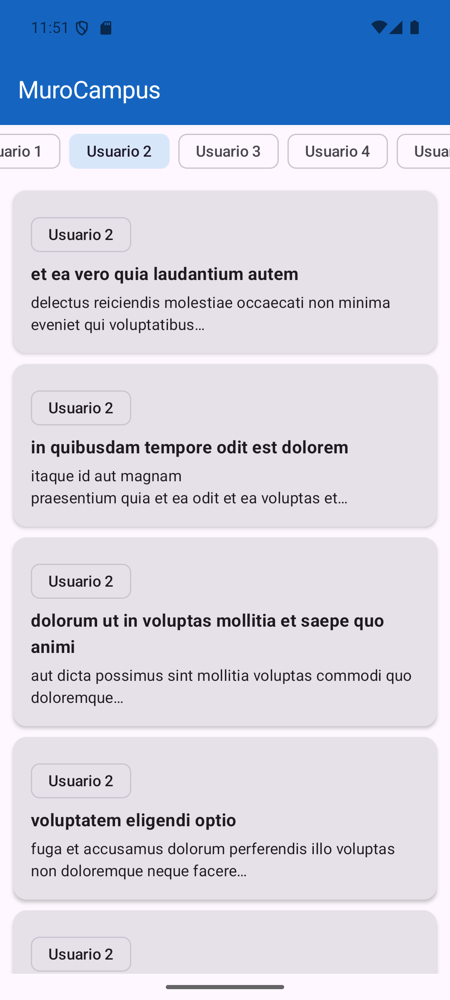

# MuroCampus

App Android en Kotlin que usa un servicio web (JSONPlaceholder). Muestra una lista de publicaciones, el detalle de cada una con sus comentarios, un filtro por usuario y una pantalla para crear publicaciones. Si no hay internet, la app no se cierra: muestra un mensaje y un botón Reintentar.

Laboratorio 09 de Programación en Móviles (Tecsup), Servicios Web. Erick Gamarra.

## Capturas

| Lista | Detalle | Filtro (Usuario 2) | Crear | Sin conexión |
|---|---|---|---|---|
|  |  |  |  |  |

## Carpetas

```
com.tecsup.murocampus/
├── MainActivity.kt                  cambia entre lista, detalle y crear
├── model/
│   └── Modelos.kt                   Usuario, Post, Comentario, NuevoPost
├── data/
│   ├── remote/
│   │   ├── PostApi.kt               llamadas de Retrofit
│   │   ├── RetrofitClient.kt        cliente de Retrofit y OkHttp
│   │   └── UsuarioApi.kt            ejemplo del proyecto base
│   ├── PostRepository.kt            devuelve Result
│   └── UsuarioRepository.kt         ejemplo del proyecto base
├── viewmodel/
│   ├── UiState.kt                   Cargando, Exito y Error
│   ├── PostsViewModel.kt            lista, detalle, filtro y crear
│   └── PostsViewModelFactory.kt
└── ui/
    ├── Componentes.kt               tarjeta, cargando y error
    ├── PantallaLista.kt
    ├── PantallaDetalle.kt
    ├── PantallaCrear.kt
    └── theme/
```

## Arquitectura MVVM + Repository

```
 Pantallas (PantallaLista, PantallaDetalle, PantallaCrear)
   | botones: cargar, abrir, filtrar, publicar     ^ collectAsStateWithLifecycle()
   v                                               |
 ViewModel (PostsViewModel) --- StateFlow<UiState> (Cargando / Exito / Error) --->
   | viewModelScope.launch
   v
 PostRepository              <- devuelve Result
   -> PostRepositoryRemote      (atrapa los errores de red)
   |
   v
 PostApi (Retrofit) --- OkHttp ---> https://jsonplaceholder.typicode.com/
```

- Las pantallas solo hablan con el ViewModel.
- El ViewModel solo habla con el Repository. No usa Retrofit.
- El Repository atrapa los errores y los devuelve como `Result`, así la app no se cierra.

## Pruebas (Paso 10)

| Prueba | Qué hice | Resultado | OK |
|---|---|---|---|
| Sin internet | Activé el modo avión y abrí la app | Sale «Sin conexión a internet» y Reintentar | ✅ |
| Reintentar | Quité el modo avión y pulsé Reintentar | Carga la lista | ✅ |
| Recurso que no existe | Cambié la ruta a `posts/9999` (solo para probar) | Sale «Error del servidor (404)» | ✅ |
| JSON diferente | Quité `body` de Post / agregué un campo que no llega (solo para probar) | Sigue funcionando / sale «Respuesta inesperada» | ✅ |
| Cancelación | Abrí el detalle y volví rápido varias veces | No hubo errores en Logcat | ✅ |
| Lista y detalle | Abrí varias publicaciones | Siempre 5 comentarios | ✅ |
| Filtro | Elegí cada usuario | Siempre 10 publicaciones | ✅ |
| Crear | Envié una publicación | Sale «Publicado con id 101» | ✅ |
| Código | Revisé `viewmodel/` | `PostsViewModel` no usa Retrofit, PostApi ni HttpException | ✅ |

Quité todos los cambios de prueba antes del commit. El único `HttpException` de `viewmodel/` está en `UiState.kt`, que venía en el proyecto base.

## Para pensar

**1. ¿Qué diferencia hay entre GET y POST? ¿Por qué crear lleva @Body y porUsuario lleva @Query?**
GET sirve para leer datos y POST para crear. `crear` usa `@Body` porque manda toda la publicación en JSON. `porUsuario` usa `@Query` porque solo manda el número del usuario en la URL (`posts?userId=2`).

**2. ¿Por qué la ruta es "posts" y no "/posts"?**
Si la ruta empieza con `/`, Retrofit la toma desde la raíz del sitio y se pierde parte de la URL base. Con `"posts"` se agrega al final de la URL base, que termina en `/`.

**3. ¿Por qué el Repository devuelve Result en vez de dejar que la excepción llegue al ViewModel?**
Para que el ViewModel no tenga que manejar errores de red. Solo recibe si salió bien o mal, y así la app no se cierra por un error que se escapó.

**4. ¿Qué pasa si olvidas el permiso INTERNET? ¿Y si olvidas ignoreUnknownKeys y el servidor agrega un campo nuevo?**
Sin el permiso, todas las llamadas fallan aunque haya internet. Sin `ignoreUnknownKeys`, si el servidor agrega un campo nuevo la app falla con «Respuesta inesperada».

**5. ¿Por qué la pantalla de lista usa un when sobre UiState y no un if con tres variables?**
Con el `when` solo hay un estado a la vez y no se puede olvidar ninguno. Con tres variables podrían quedar mezcladas, por ejemplo cargando y con error al mismo tiempo.

**6. JSONPlaceholder no guarda los POST. ¿Cómo cambiaría tu app si usaras un servicio real?**
La publicación sí se guardaría, así que habría que actualizar la lista después de crearla. También habría que usar un token de inicio de sesión y el id del usuario real.
