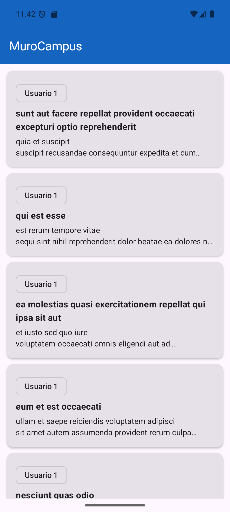
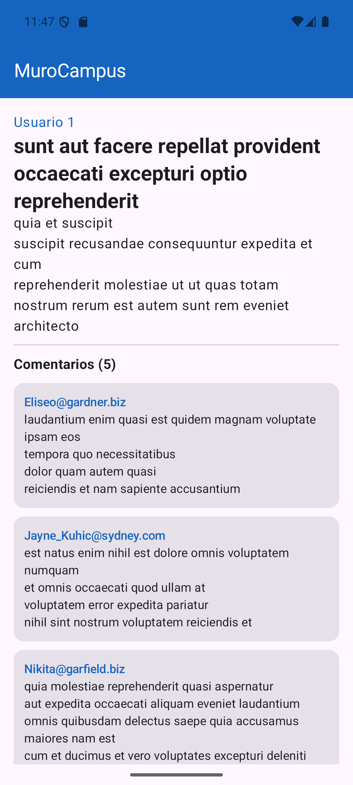
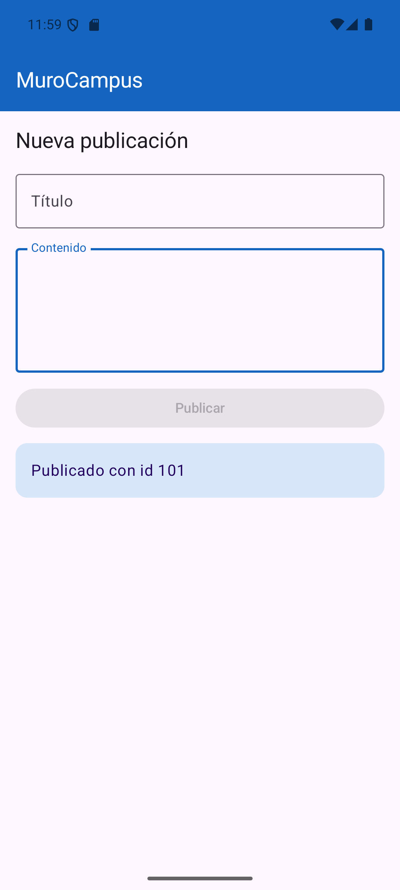
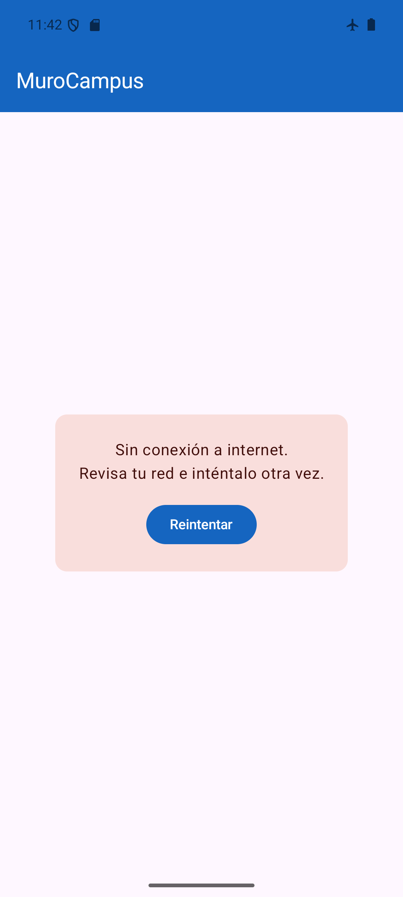

# MuroCampus

App Android en Kotlin que consume un servicio web REST (JSONPlaceholder). Lista publicaciones, muestra el detalle de cada una con sus comentarios, filtra por usuario y crea una publicación nueva con POST. Si no hay internet o el servidor responde con error, la app no se cierra: muestra el mensaje y un botón Reintentar.

Laboratorio 09 de Programación en Móviles (Tecsup) · Servicios Web y plataforma REST · Erick Gamarra · trabajo individual

## Capturas

| Lista | Detalle | Filtro (Usuario 2) | Crear | Sin conexión |
|---|---|---|---|---|
|  |  |  |  |  |

## Estructura de paquetes

```
com.tecsup.murocampus/
├── MainActivity.kt                  navegación con idSeleccionado / creando y BackHandler
├── model/
│   └── Modelos.kt                   Usuario, Post, Comentario, NuevoPost
├── data/
│   ├── remote/
│   │   ├── PostApi.kt               interface de Retrofit (@GET, @Path, @Query, @POST, @Body)
│   │   ├── RetrofitClient.kt        object con OkHttp, logging y conversor JSON
│   │   └── UsuarioApi.kt            ejemplo resuelto
│   ├── PostRepository.kt            interface + PostRepositoryRemote (devuelve Result)
│   └── UsuarioRepository.kt         ejemplo resuelto
├── viewmodel/
│   ├── UiState.kt                   Cargando / Exito / Error y mensajeDe()
│   ├── PostsViewModel.kt            lista, detalle, filtro y publicar
│   └── PostsViewModelFactory.kt
└── ui/
    ├── Componentes.kt               TarjetaPost, Cargando, ErrorConReintento
    ├── PantallaLista.kt             chips de usuario + lista
    ├── PantallaDetalle.kt           publicación y comentarios
    ├── PantallaCrear.kt             formulario del POST
    └── theme/
```

## Arquitectura MVVM + Repository

```
 View (PantallaLista, PantallaDetalle, PantallaCrear)
   | eventos: cargar, abrir, filtrar, publicar     ^ collectAsStateWithLifecycle()
   v                                               |
 ViewModel (PostsViewModel) --- StateFlow<UiState> (Cargando / Exito / Error) --->
   | viewModelScope.launch
   v
 PostRepository (interface)        <- devuelve Result<...>
   -> PostRepositoryRemote           (captura IOException, HttpException, SerializationException)
   |
   v
 PostApi (Retrofit) --- OkHttp ---> https://jsonplaceholder.typicode.com/
```

- La pantalla solo conoce al ViewModel y dibuja el estado con un `when`.
- `PostsViewModel` solo conoce la interface `PostRepository`: no importa Retrofit, PostApi, HttpException ni Context.
- El Repository nunca deja escapar una excepción: la convierte en `Result.failure` (y relanza `CancellationException`).

## Pruebas de errores (Paso 10)

| Prueba | Cómo la hice | Resultado | OK |
|---|---|---|---|
| Sin internet | Modo avión y abrir la app | «Sin conexión a internet» con Reintentar | ✅ |
| Reintentar | Quitar el modo avión y pulsar Reintentar | Carga la lista | ✅ |
| Recurso inexistente | `posts/{id}` cambiado a `posts/9999` (temporal) | «Error del servidor (404)» | ✅ |
| JSON inesperado | Quitar `body` de Post (temporal) / agregar `autor` que no llega (temporal) | Funciona por `ignoreUnknownKeys` / «Respuesta inesperada» | ✅ |
| Cancelación | Abrir el detalle y volver rápido 5 veces | 0 errores de la app en Logcat | ✅ |
| Lista y detalle | Abrir las publicaciones 1, 2 y 3 | Siempre Comentarios (5) | ✅ |
| Filtro | Elegir Usuario 1 a Usuario 10 | Siempre 10 publicaciones (`posts?userId=N`) | ✅ |
| Crear | Enviar una publicación | «Publicado con id 101», POST con respuesta 201 | ✅ |
| Código | Revisar `viewmodel/` | `PostsViewModel` no tiene Retrofit, PostApi ni HttpException | ✅ |

Los cambios temporales se deshicieron antes del commit. En `viewmodel/` el único `HttpException` está en `mensajeDe()` de `UiState.kt` y `RetrofitClient` solo aparece en `PostsViewModelFactory.kt`; los dos son archivos entregados en el proyecto base.

## Para pensar

**1. ¿Qué diferencia hay entre GET y POST? ¿Por qué crear lleva @Body y porUsuario lleva @Query?**
GET solo lee un recurso y no cambia nada en el servidor; POST envía datos para crear un recurso nuevo. `crear` lleva `@Body` porque la publicación completa viaja como JSON en el cuerpo de la petición. `porUsuario` solo necesita un dato para filtrar, y ese dato va en la URL como parámetro (`posts?userId=2`), por eso es `@Query`.

**2. ¿Por qué la ruta es "posts" y no "/posts"?**
Retrofit combina la ruta con la `baseUrl`. Si la ruta empieza con `/` se toma como absoluta desde la raíz del dominio y reemplaza el camino que tenga la URL base. Con `"posts"` se agrega al final de `https://jsonplaceholder.typicode.com/`, que por eso también debe terminar en `/`.

**3. ¿Por qué el Repository devuelve Result en vez de dejar que la excepción llegue al ViewModel?**
Así el ViewModel no necesita conocer los errores de red (IOException, HttpException…) ni llenarse de try/catch. Solo recibe éxito o fallo y lo convierte en un UiState. Además, si cambio la fuente de datos (por ejemplo, Room), el ViewModel y la pantalla no cambian, y no hay riesgo de que una excepción olvidada cierre la app.

**4. ¿Qué pasa si olvidas el permiso INTERNET? ¿Y si olvidas ignoreUnknownKeys y el servidor agrega un campo nuevo?**
Sin el permiso la app compila, pero toda llamada falla con un error de red (SecurityException o UnknownHostException), y se vería «Sin conexión» aunque haya internet. Sin `ignoreUnknownKeys`, cualquier campo nuevo que mande el servidor hace fallar la conversión con SerializationException y la pantalla mostraría «Respuesta inesperada».

**5. ¿Por qué la pantalla de lista usa un when sobre UiState y no un if con tres variables?**
Con una sealed interface el estado es uno solo a la vez y el `when` obliga a cubrir los tres casos. Con tres variables (cargando, error, datos) podrían quedar combinaciones imposibles, como cargando y error al mismo tiempo, y habría que acordarse de limpiar cada una.

**6. JSONPlaceholder no guarda los POST. ¿Cómo cambiaría tu app si usaras un servicio real?**
La publicación creada sí aparecería al recargar, así que después del POST actualizaría la lista (volviendo a pedirla o agregando el Post que devuelve el servidor). También habría que manejar autenticación (un token en un encabezado), validar los errores 400/401 que devuelva el servidor y usar el id real de cada usuario en vez de `userId = 1`.
