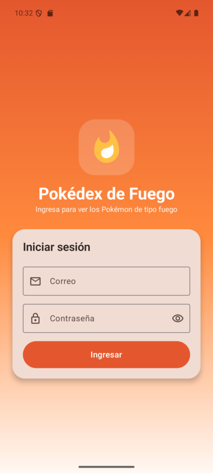
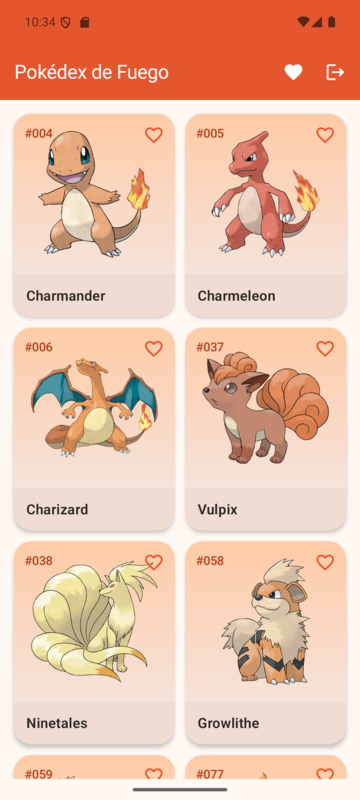
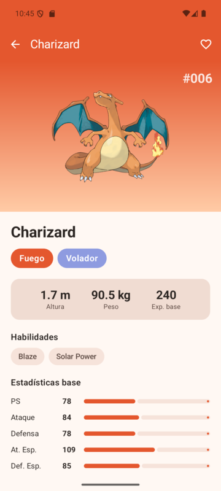
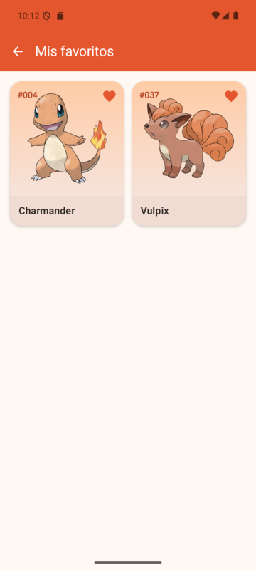
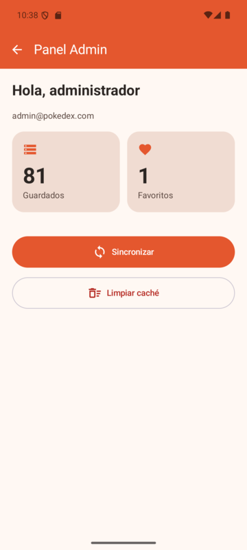
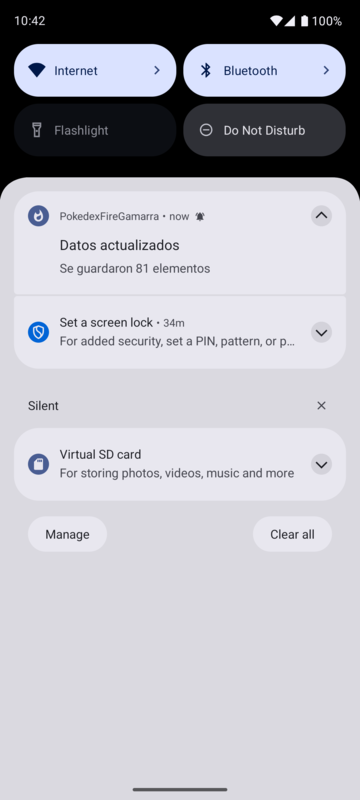
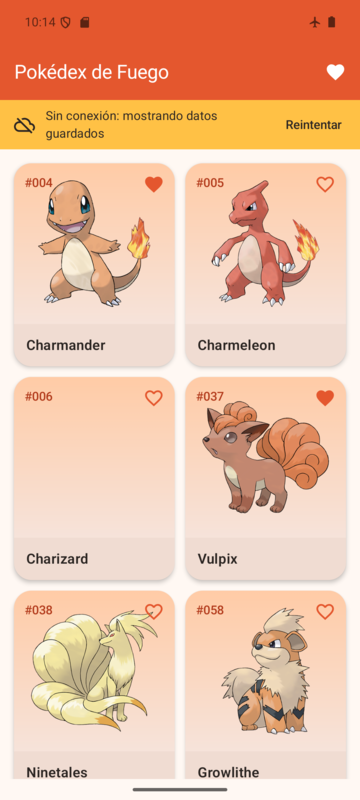
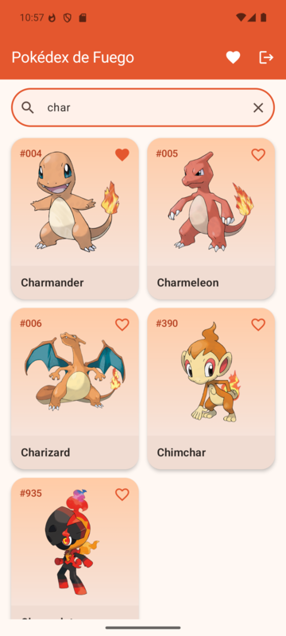
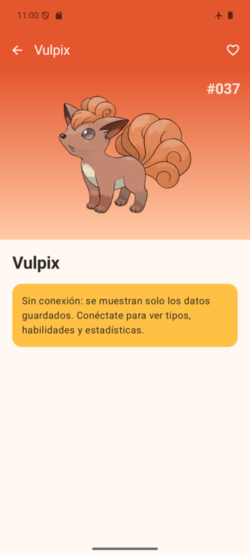
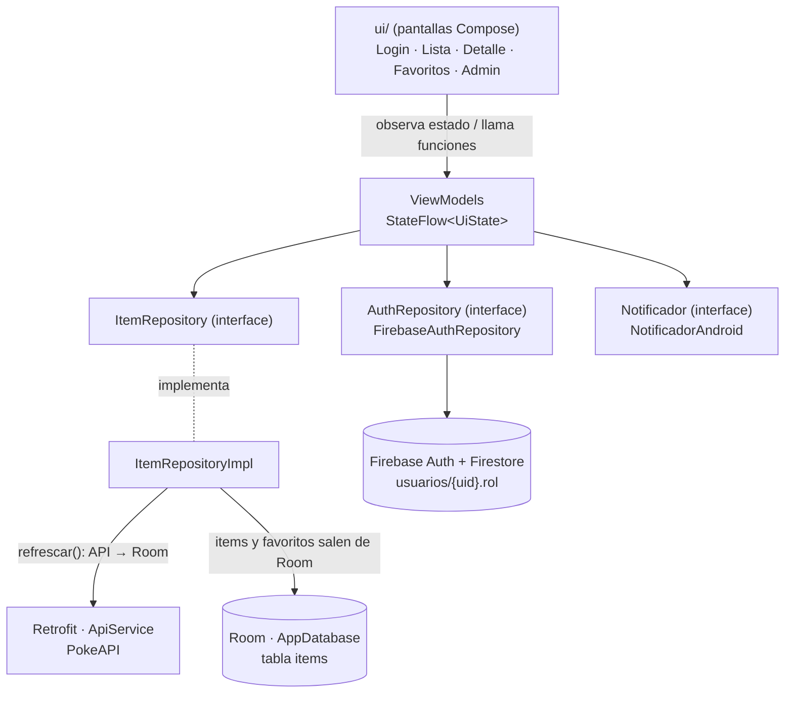

# Pokédex de Fuego

App Android en Kotlin que muestra los Pokémon de tipo **fuego**. Tiene ingreso con Firebase y dos roles (admin y usuario). La lista viene de internet, se guarda en el celular con Room y funciona sin conexión. Se pueden marcar favoritos, y al sincronizar llega una notificación local.

Laboratorio 11-12 de Programación en Móviles (Tecsup) · Erick Gamarra · trabajo individual

| Dato | Valor |
|---|---|
| Tema | Pokémon (grupo G08) |
| Variante | Tipo `fire` |
| API base | `https://pokeapi.co/api/v2/` |
| Lista | `GET type/fire` (81 especies; se omiten las formas especiales con id ≥ 10000) |
| Detalle | `GET pokemon/{nombre}` |
| Paquete | `com.tecsup.pokemon` |

## Capturas

| Login | Lista | Detalle | Favoritos |
|---|---|---|---|
|  |  |  |  |

| Panel Admin | Notificación | Sin conexión |
|---|---|---|
|  |  |  |

## Fase 2: mejoras con IA (rama `mejora-ia-pokemon`)

| Mejora | Detalle |
|---|---|
| Pruebas unitarias (R12) | 7 pruebas del `ListaViewModel` con `RepositorioFalso` y `NotificadorFalso` (`app/src/test`) |
| Buscador | Filtra por nombre o número (`char`, `#006`) desde el ViewModel |
| Deslizar para sincronizar | `PullToRefreshBox` sin perder la lista de la pantalla |
| Detalle sin conexión | Sin internet muestra la ficha guardada en Room con un aviso |

| Buscador | Detalle sin conexión |
|---|---|
|  |  |

Las consultas a la IA están en [PROMPTS.md](PROMPTS.md). Para correr las pruebas: `./gradlew :app:testDebugUnitTest`.

## Tecnologías

| Tema | Uso |
|---|---|
| Interfaz | Jetpack Compose + Material 3 (sin XML), Navigation Compose, Coil para las imágenes |
| Arquitectura | MVVM: `UiState`, ViewModel con `StateFlow` y `ItemRepository` como interface |
| Red | Retrofit 2.11 + kotlinx-serialization + OkHttp 4.12 |
| Base local | Room 2.8.4 con KSP (Entity, Dao y Database) |
| Ingreso | Firebase Authentication (correo y contraseña) + Firestore para el rol |
| Avisos | Notificación local con canal y permiso `POST_NOTIFICATIONS` |

## Arquitectura



- **Room es la fuente única de verdad.** La lista siempre sale de Room; Retrofit solo la actualiza.
- **Los favoritos no se pierden al sincronizar.** Antes del `@Upsert` se leen los ids favoritos y se vuelven a aplicar.
- **El rol no se decide en la app.** Se lee de Firestore (`usuarios/{uid}`, campo `rol`) y solo cambia lo que se muestra.
- **El ViewModel no recibe `Context`.** La notificación se pide con la interface `Notificador`.
- Tres modelos: `ItemDto` (API) → `ItemEntity` (Room) → `Item` (UI), convertidos en `data/mapper/Mappers.kt`.

## Estructura

```
app/src/main/java/com/tecsup/pokemon/
├── MainActivity.kt          ← pide el permiso de notificaciones y arranca AppNav
├── AppContainer.kt          ← crea API, base de datos, repositorios y notificador
├── data/
│   ├── remote/              ApiService · RetrofitClient · dto/ItemDto.kt
│   ├── local/               ItemEntity · ItemDao · AppDatabase
│   ├── auth/                AuthRepository · FirebaseAuthRepository
│   ├── repository/          ItemRepository · ItemRepositoryImpl
│   └── mapper/              Mappers.kt
├── domain/model/            Item · Sesion (Rol)
├── notification/            Notificador · NotificadorAndroid
└── ui/
    ├── navigation/AppNav.kt
    ├── UiState.kt
    ├── login/ · lista/ · detalle/ · favoritos/ · admin/
    ├── components/          Cargando · ErrorView · TarjetaPokemon
    └── theme/
```

## Cómo compilar

1. Abrir la carpeta `Semana12/PokedexFireGamarra` en Android Studio y sincronizar Gradle.
2. Colocar `google-services.json` dentro de `app/`. **No está en el repositorio** porque tiene la clave de API (ver `.gitignore`); se descarga de la consola de Firebase del proyecto.
3. Ejecutar en un emulador con Google Play (API 33 o superior para ver el permiso de notificaciones).

## Usuarios de prueba (Firebase)

1. En Firebase Console → Authentication → Método de acceso, activar **Correo electrónico/contraseña**.
2. En Authentication → Usuarios, crear dos usuarios con una contraseña de al menos 6 caracteres:

| Rol | Correo |
|---|---|
| Admin | `admin@pokedex.com` |
| Usuario | `usuario@pokedex.com` |

   Las contraseñas no se guardan en el repositorio; se entregan al docente aparte.

3. En Firestore, crear la colección `usuarios` con un documento por usuario. **El ID del documento es el UID** copiado de Authentication, con los campos `rol` (`admin` o `usuario`) y `nombre`.
4. Publicar las reglas:

```
rules_version = '2';
service cloud.firestore {
  match /databases/{database}/documents {
    match /usuarios/{uid} {
      allow read: if request.auth != null && request.auth.uid == uid;
      allow write: if false;
    }
  }
}
```

## Pruebas de aceptación

| Cód. | Caso | Resultado |
|---|---|---|
| PA-01 | Ingresar con el usuario `usuario` | Entra al catálogo y no ve el panel Admin ✔ |
| PA-02 | Ingresar con el usuario `admin` | Ve el botón del panel Admin ✔ |
| PA-03 | Contraseña incorrecta | "Correo o contraseña incorrectos" ✔ |
| PA-04 | Correo o clave vacíos | Validación sin llamar a Firebase ✔ |
| PA-05 | Primera apertura con internet | Cargando, lista y notificación "Se guardaron 81 elementos" ✔ |
| PA-06 | Tocar un Pokémon | Detalle con datos de `pokemon/{nombre}` ✔ |
| PA-07 | Marcar favorito y cerrar la app | Sigue en Favoritos al reabrir ✔ |
| PA-08 | Modo avión con datos guardados | Lista con el aviso "Sin conexión" ✔ |
| PA-09 | Modo avión sin datos | Error con botón Reintentar ✔ |
| PA-10 | Sincronizar después de marcar favorito | El favorito se conserva ✔ |
| PA-11 | Admin pulsa Limpiar caché | Totales en 0; al sincronizar vuelven ✔ |
| PA-12 | Cerrar sesión y reabrir | Vuelve al login ✔ |
| PA-13 | Girar la pantalla | No se pierde el estado ni se vuelve a descargar ✔ |
| PA-14 | Negar el permiso de notificaciones | La app funciona normal, sin avisos ✔ |

## Reparto de tareas

Trabajo individual: todos los hitos (H1 a H16), la configuración de Firebase, las pruebas y la documentación los hizo Erick Gamarra.

## Commits

Un commit por hito, con el formato `tipo: descripción` de la guía (`chore`, `feat`, `fix`, `refactor`, `docs`).
