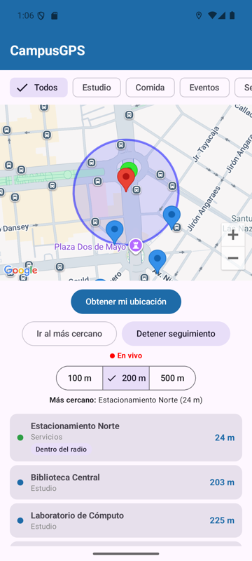
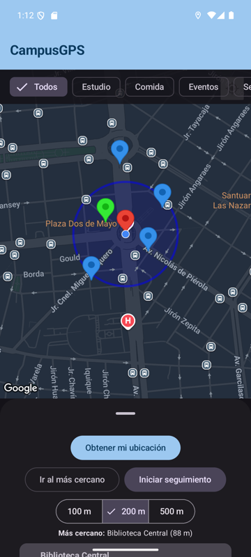
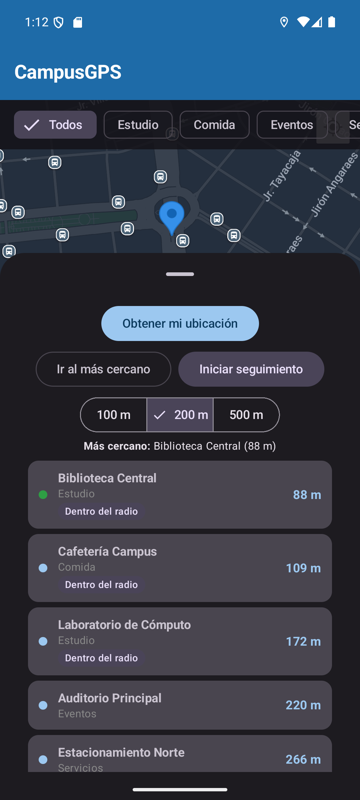

# PROMPTS.md · Fase 2 con IA

Usé Gemini dentro de Android Studio (panel Agent, Gemini 3.6 Flash), en la rama `mejora-ia-campusgps`. Para cada mejora abrí un chat nuevo y le pegué un prompt largo y bien detallado, porque cuando le pedía algo corto metía lógica en las pantallas o le pasaba el ViewModel a todo. Después de cada respuesta revisé los cambios con `git diff`, lo probé en el emulador y recién ahí hice el commit.

## Resumen

| Mejora | Qué cambió | Commit |
|---|---|---|
| 1. Filtro por categoría | ViewModel + pantalla | `feat(ia): filtra lugares por categoria con chips en mapa y lista` |
| 2. Radio de cercanía | ViewModel + pantalla | `feat(ia): agrega radio de cercania con circulo en el mapa y etiqueta en la lista` |
| 3. Seguimiento en vivo | Repository + ViewModel + pantalla | `feat(ia): seguimiento en vivo con requestLocationUpdates y callbackFlow` |
| 4. Punto azul, modo oscuro y panel | Solo pantalla | `feat(ia): punto azul nativo, mapa oscuro y panel inferior deslizable` |

| Filtro | Radio | En vivo | Modo oscuro | Panel |
|---|---|---|---|---|
|  |  |  |  |  |

## Tabla de prompts

| Prompt que escribí | Qué respondió Gemini | Qué cambié o descarté | Por qué |
|---|---|---|---|
| Prompt 1 (filtro por categoría), completo abajo | Creó `FiltroCategorias.kt` con los chips, agregó el filtro en el ViewModel y cambió la pantalla para usar la lista filtrada. Me pidió permiso para agregar la librería de íconos al Gradle. | Acepté la librería. Cambié el valor inicial de la lista filtrada (puso una lista vacía) y que el texto del más cercano tome la distancia de la lista completa. | Con la lista vacía, al abrir la app la lista se veía vacía un momento. Y si filtraba por Comida, el texto del más cercano se quedaba sin metros. |
| Prompt 2 (radio de cercanía), completo abajo | Hizo el selector de 100/200/500 m, el círculo en el mapa y la etiqueta "Dentro del radio". | Al aceptar, me volvió a poner la lista vacía como valor inicial (pisó mi arreglo anterior). Lo corregí otra vez. Lo demás lo dejé igual. | Gemini trabaja con su copia del archivo y no ve lo que cambié a mano. Por eso siempre reviso el diff completo. |
| Prompt 3 (seguimiento en vivo), completo abajo | Hizo el seguimiento en el Repository con `callbackFlow` y además revisó solo si el GPS está apagado. En la pantalla reutilizó el pedido de permisos. | Los errores del seguimiento los mandaba todos como `OTRO`. Los cambié para usar `errorDe()`, la misma función que ya usaba al buscar. También volví a corregir el valor inicial. | Así, si se apaga el GPS durante el seguimiento, sale el mismo mensaje con Reintentar que cuando buscas una vez. |
| Prompt 4 (punto azul, modo oscuro y panel), completo abajo | Agregó el punto azul, el estilo oscuro del mapa y cambió la pantalla a un panel que se desliza desde abajo. | En modo oscuro la barra de arriba salía celeste y el título casi no se leía. La dejé siempre en el azul de la app. | La guía pide la barra azul, y además así se lee bien en los dos modos. |

## Prompts completos (tal como los escribí en Gemini)

### Prompt 1 · Filtro por categoría

```text
Proyecto Android Kotlin + Jetpack Compose con arquitectura MVVM + Repository (paquete com.tecsup.campusgps). Quiero agregar un FILTRO POR CATEGORÍA. Reglas estrictas: 1) En viewmodel/MapaViewModel.kt agrega private val _categoria = MutableStateFlow<String?>(null), su StateFlow público categoria, y fun filtrarPor(categoria: String?). Agrega val lugaresVisibles: StateFlow<List<LugarConDistancia>> combinando lugares y categoria con combine(...).stateIn(viewModelScope, SharingStarted.WhileSubscribed(5000), emptyList()); si categoria es null devuelve todos. Agrega val categorias: List<String> = lugaresRepo.obtenerLugares().map { it.categoria }.distinct(). 2) Crea ui/FiltroCategorias.kt con un @Composable FiltroCategorias(categorias: List<String>, seleccionada: String?, onSeleccionar: (String?) -> Unit, modifier: Modifier) que muestre una LazyRow de FilterChip de Material 3: primer chip Todos (null) y luego uno por categoría, con leadingIcon Icons.Filled.Check cuando está seleccionado. 3) En ui/PantallaMapa.kt coloca FiltroCategorias justo debajo del TopAppBar y pasa lugaresVisibles (no lugares) a MapaUbicacion y a ListaLugares. NO cambies masCercano (se sigue calculando sobre todos los lugares). NO pases el ViewModel a FiltroCategorias, NO uses Context en el ViewModel, NO pongas lógica de filtrado dentro de un Composable. Muestra el código completo de cada archivo modificado.
```

### Prompt 2 · Radio de cercanía

```text
Proyecto Android Kotlin + Jetpack Compose (MVVM + Repository, paquete com.tecsup.campusgps). Ya existen MapaViewModel (con lugares, lugaresVisibles, estado y la data class LugarConDistancia(lugar, metros: Float?)), MapaUbicacion.kt (GoogleMap de maps-compose) y ListaLugares.kt. Agrega un RADIO DE CERCANÍA. Reglas estrictas: 1) En MapaViewModel agrega private val _radio = MutableStateFlow(200), val radio: StateFlow<Int>, val radiosDisponibles = listOf(100, 200, 500) y fun cambiarRadio(metros: Int). 2) Crea ui/SelectorRadio.kt con @Composable SelectorRadio(radios: List<Int>, seleccionado: Int, onCambiar: (Int) -> Unit, modifier: Modifier) usando SingleChoiceSegmentedButtonRow y SegmentedButton de Material 3 con etiquetas como 100 m, 200 m, 500 m. 3) En MapaUbicacion agrega el parámetro radioMetros: Int y, cuando estado sea UbicacionUi.Lista, dibuja un Circle de maps-compose centrado en la posición del usuario con radius = radioMetros.toDouble(), strokeColor azul semitransparente y fillColor azul con alpha 0.12. 4) En ListaLugares agrega el parámetro radioMetros: Int y en cada tarjeta, si metros != null && metros <= radioMetros, muestra una etiqueta pequeña Dentro del radio (un Surface redondeado con color secondaryContainer). La comparación metros <= radio es solo de presentación, no la muevas al Repository. 5) En PantallaMapa coloca SelectorRadio debajo de los botones y pasa radio a MapaUbicacion y ListaLugares. NO pases el ViewModel a los nuevos composables y NO uses Context en el ViewModel. Edita los archivos directamente.
```

### Prompt 3 · Seguimiento en vivo

```text
Proyecto Android Kotlin + Jetpack Compose (MVVM + Repository, paquete com.tecsup.campusgps). Agrega SEGUIMIENTO EN VIVO de la ubicación. Reglas estrictas: 1) En data/UbicacionRepository.kt agrega a la interface fun seguirPosicion(): Flow<Posicion>. 2) En data/UbicacionRepositoryGoogle.kt impleméntalo con callbackFlow: crea un LocationRequest.Builder(Priority.PRIORITY_HIGH_ACCURACY, 3000L).setMinUpdateDistanceMeters(2f).build(), un LocationCallback que haga trySend(Posicion(lat, lon)) por cada ubicación de locationResult.locations, llama a cliente.requestLocationUpdates(request, callback, Looper.getMainLooper()) con @SuppressLint(MissingPermission), y en awaitClose { cliente.removeLocationUpdates(callback) }. 3) En viewmodel/MapaViewModel.kt agrega private var trabajoSeguimiento: Job? = null, private val _siguiendo = MutableStateFlow(false), val siguiendo: StateFlow<Boolean>, fun iniciarSeguimiento() que cancele el job anterior y lance en viewModelScope ubicacionRepo.seguirPosicion().catch { _estado.value = UbicacionUi.Error(it.message ?: Error de seguimiento, TipoError.OTRO); _siguiendo.value = false }.collect { pos -> _estado.value = UbicacionUi.Lista(pos); actualizarDistancias(pos) }, y fun detenerSeguimiento() que cancele el job y ponga _siguiendo en false. Antes de iniciar verifica playServicesDisponible() igual que buscar(). Sobrescribe onCleared() para cancelar el job. 4) En ui/PantallaMapa.kt agrega un FilledTonalButton Iniciar seguimiento / Detener seguimiento junto a Ir al más cercano en un Row; al iniciar, usa la MISMA verificación de permisos que alPulsar() (si no hay permiso, lanza el launcher; cuando se conceda, llama a la acción pendiente). Mientras siguiendo sea true muestra el texto En vivo con un punto rojo. NO uses Context en el ViewModel, NO llames a FusedLocationProviderClient fuera del Repository. Edita los archivos directamente.
```

### Prompt 4 · Punto azul, modo oscuro y panel

```text
Proyecto Android Kotlin + Jetpack Compose (MVVM + Repository, paquete com.tecsup.campusgps). Solo cambios de la capa View, sin tocar ViewModel ni Repository. Necesito 3 cosas: 1) PUNTO AZUL NATIVO: en ui/MapaUbicacion.kt agrega el parámetro permisoConcedido: Boolean y pasa a GoogleMap properties = MapProperties(isMyLocationEnabled = permisoConcedido, mapStyleOptions = ...) y uiSettings = MapUiSettings(myLocationButtonEnabled = permisoConcedido, zoomControlsEnabled = false). En ui/PantallaMapa.kt calcula permisoConcedido con ContextCompat.checkSelfPermission (FINE o COARSE) dentro de un remember(estado) para que se recalcule al cambiar el estado. 2) MAPA EN MODO OSCURO: crea app/src/main/res/raw/mapa_oscuro.json con un estilo oscuro estándar de Google Maps (geometry #242f3e, labels.text.fill #746855, water #17263c, road #38414e, etc.). En MapaUbicacion usa isSystemInDarkTheme() y, si es true, MapStyleOptions.loadRawResourceStyle(LocalContext.current, R.raw.mapa_oscuro), dentro de remember(oscuro). 3) DISEÑO: en PantallaMapa reemplaza la columna de controles fija por un BottomSheetScaffold de Material 3 (sheetPeekHeight = 260.dp) cuyo contenido del sheet sea: los botones, el SelectorRadio, el texto Más cercano, el MensajeError y ListaLugares con Modifier.heightIn(max = 360.dp). El mapa debe ocupar toda la pantalla detrás del sheet, y FiltroCategorias debe quedar flotando arriba del mapa sobre un Surface con fondo semitransparente. Mantén el TopAppBar azul CampusGPS. Agrega WindowInsets correctos. NO pases el ViewModel a los composables hijos, NO muevas lógica a los composables. Edita los archivos directamente.
```

## Cómo comprobé que no se rompió MVVM

- El ViewModel sigue sin recibir `Context`.
- El `FusedLocationProviderClient` solo está en `UbicacionRepositoryGoogle.kt`.
- Los composables nuevos (`FiltroCategorias`, `SelectorRadio`) reciben datos y funciones, no el ViewModel.
- Probé todo en el emulador: el filtro de Estudio, el radio de 500 m, el seguimiento moviendo la ubicación y el modo oscuro.

## Lo que aprendí

Gemini funciona mejor si le dices exactamente qué archivo tocar, qué nombres usar y qué no hacer. Aun así, en las tres mejoras que tocaban el ViewModel me deshizo una corrección, porque trabaja con su copia del archivo. Por eso no me fío del resumen que da al final: reviso el `git diff` antes de cada commit.
