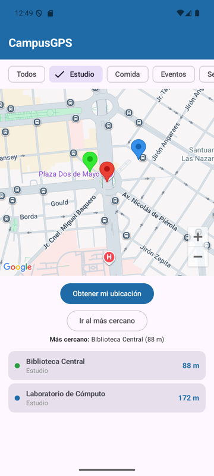
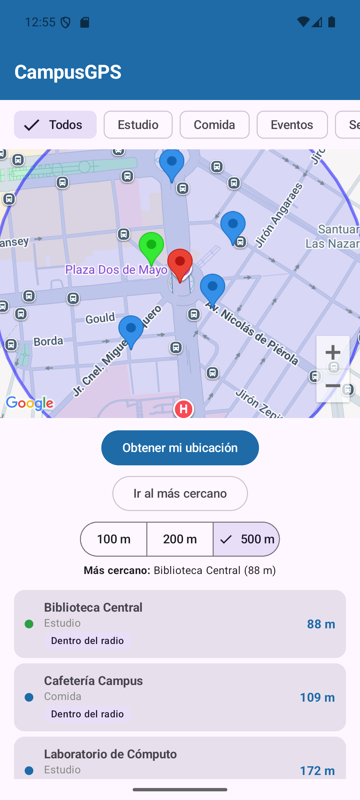

# PROMPTS.md · Fase 2 con IA

Rama `mejora-ia-campusgps`. Usé **Gemini en Android Studio** (modo Agent, modelo Gemini 3.6 Flash). Abrí un chat nuevo por mejora para que no arrastrara contexto de la anterior. Cada prompt dice exactamente qué archivo tocar, qué firma usar y qué **no** hacer, porque sin eso Gemini tiende a meter lógica en los Composables o a pasar el ViewModel a todos lados.

Regla que seguí siempre: **la IA propone, yo decido**. Antes de hacer commit revisé el diff con `git diff`, compilé y probé en el emulador.

## Mejoras hechas

| # | Mejora | Capas que cambian | Commit |
|---|---|---|---|
| 1 | Filtrar por categoría (chips) | ViewModel + View | `feat(ia): filtra lugares por categoria con chips en mapa y lista` |
| 2 | Radio de cercanía (100/200/500 m) con `Circle` | ViewModel + View | `feat(ia): agrega radio de cercania con circulo en el mapa y etiqueta en la lista` |
| 3 | Seguimiento en vivo con `callbackFlow` | Repository + ViewModel + View | `feat(ia): seguimiento en vivo con requestLocationUpdates y callbackFlow` |
| 4 | Punto azul nativo + mapa oscuro + panel inferior | View | `feat(ia): punto azul nativo, mapa oscuro y panel inferior deslizable` |

| Filtro | Radio | En vivo | Modo oscuro | Panel |
|---|---|---|---|---|
|  |  |  |  |  |

## Tabla de prompts

| Prompt que escribí | Qué respondió Gemini | Qué cambié o descarté | Por qué |
|---|---|---|---|
| «…agrega un FILTRO POR CATEGORÍA… en MapaViewModel `_categoria`, `filtrarPor()`, `lugaresVisibles` con `combine(...).stateIn(...)`… crea `ui/FiltroCategorias.kt` con `LazyRow` de `FilterChip`… NO pases el ViewModel a FiltroCategorias, NO uses Context en el ViewModel, NO pongas lógica de filtrado en un Composable» | Creó `FiltroCategorias.kt`, agregó el filtrado con `combine` en el ViewModel y cambió la pantalla para usar `lugaresVisibles`. Pidió permiso para agregar `material-icons-core` al Gradle porque `Icons.Filled.Check` ya no viene en el BOM. | Acepté la dependencia. Cambié dos cosas: el valor inicial de `stateIn` (puso `emptyList()`, lo dejé en `_lugares.value`) y la distancia del texto «Más cercano», que la buscaba en `lugaresVisibles`. | Con `emptyList()` la lista sale vacía un instante al abrir. Y si filtro «Comida» y el más cercano es la Biblioteca, el texto se quedaba sin metros: hay que buscar en la lista completa. |
| «…agrega un RADIO DE CERCANÍA… `_radio = MutableStateFlow(200)`, `radiosDisponibles = listOf(100, 200, 500)`, `cambiarRadio()`… `SelectorRadio` con `SingleChoiceSegmentedButtonRow`… `Circle` centrado en el usuario… etiqueta «Dentro del radio» en la tarjeta… la comparación es solo de presentación, no la muevas al Repository» | Hizo todo lo pedido: el `SegmentedButton`, el `Circle` azul semitransparente y la etiqueta con `secondaryContainer`. | Android Studio avisó un conflicto entre disco y memoria en `MapaViewModel` y la versión de Gemini **volvió a poner `emptyList()`**. Lo restauré a mano. El resto lo dejé igual. | Gemini trabaja sobre su copia en memoria y pisa correcciones hechas en disco. Por eso reviso siempre el diff completo, no solo lo que dice que hizo. |
| «…agrega SEGUIMIENTO EN VIVO… `seguirPosicion(): Flow<Posicion>` en la interface… `callbackFlow` con `LocationRequest.Builder(PRIORITY_HIGH_ACCURACY, 3000L)`… `awaitClose { removeLocationUpdates }`… en el ViewModel `Job`, `siguiendo`, `iniciarSeguimiento()`/`detenerSeguimiento()`, cancelar en `onCleared()`… misma verificación de permisos que `alPulsar()`… NO llames a FusedLocationProviderClient fuera del Repository» | Implementó el `callbackFlow` en el Repository y además, sin pedírselo, revisa si el GPS está apagado antes de pedir actualizaciones (bien pensado). En la pantalla creó `ejecutarConPermiso(accion)` con una acción pendiente para reutilizar el pedido de permiso. | En el `catch` del ViewModel convertía cualquier error en `TipoError.OTRO`. Lo cambié por `errorDe(it)`, la función que ya existía. Otra vez restauré el `stateIn` inicial. | Si el GPS está apagado debe salir el mensaje y el botón de GPS (`GPS_APAGADO`), igual que al buscar una vez. Reutilizar `errorDe()` mantiene un solo lugar donde se decide el tipo de error. |
| «…solo cambios de la capa View… PUNTO AZUL NATIVO con `MapProperties(isMyLocationEnabled = permisoConcedido)`… MAPA OSCURO con `res/raw/mapa_oscuro.json` y `MapStyleOptions` si `isSystemInDarkTheme()`… DISEÑO con `BottomSheetScaffold` (`sheetPeekHeight = 260.dp`), el mapa a pantalla completa y los chips flotando… NO pases el ViewModel a los hijos» | Agregó el estilo oscuro estándar, `MapProperties`/`MapUiSettings` y rehízo la pantalla con `BottomSheetScaffold`. `permisoConcedido` se recalcula con `remember(estado)`. | En modo oscuro la `TopAppBar` usaba `colorScheme.primary`, que en el tema oscuro es celeste, y el título blanco casi no se leía. La dejé fija en `AzulCampus` con texto blanco. | El diseño del laboratorio pide la barra azul del tema y legible. El cambio es solo de color y no afecta la arquitectura. |

## Cómo verifiqué que no se rompió MVVM

- `MapaViewModel` sigue sin recibir `Context`: `grep -n "Context" viewmodel/` solo encuentra la factory.
- `FusedLocationProviderClient` solo aparece en `UbicacionRepositoryGoogle.kt`.
- `FiltroCategorias`, `SelectorRadio`, `ListaLugares` y `MapaUbicacion` reciben datos y lambdas, nunca el ViewModel.
- El filtrado, el radio y el seguimiento viven en el ViewModel o en el Repository; la única comparación en la vista es `metros <= radio`, que solo decide si se pinta la etiqueta.
- Probé en el emulador: filtro «Estudio», radio de 500 m, seguimiento moviendo la ubicación hacia el norte (el más cercano pasó a Estacionamiento Norte, 24 m) y modo oscuro con `cmd uimode night yes`.

## Lo que aprendí usando la IA

Gemini responde mejor cuando el prompt nombra archivos, firmas y prohibiciones concretas. Aun así, en las tres mejoras que tocaron el ViewModel deshizo una corrección mía porque edita su copia en memoria. La lección es no confiar en el resumen que da al final: hay que revisar el `git diff` línea por línea antes de cada commit.
