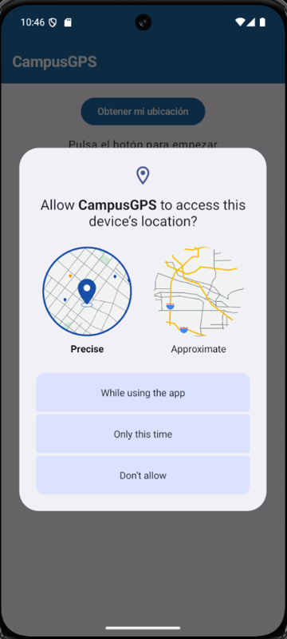
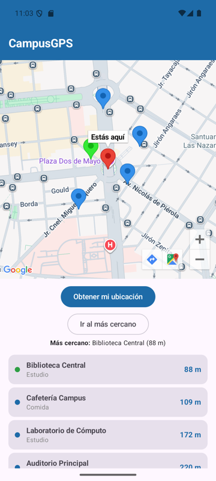
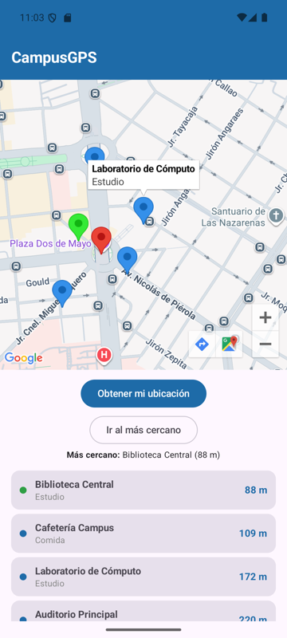
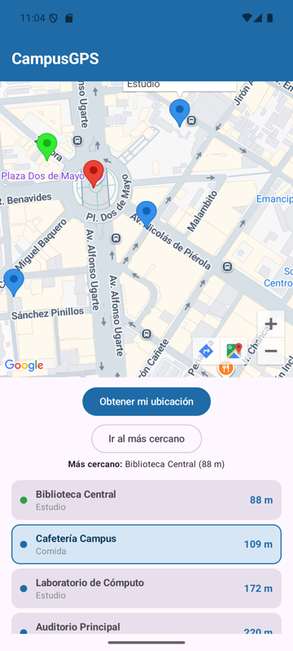
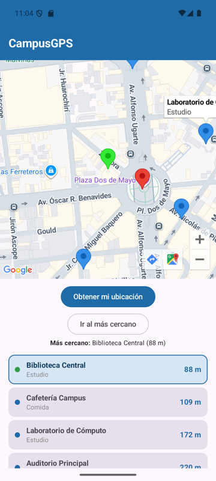
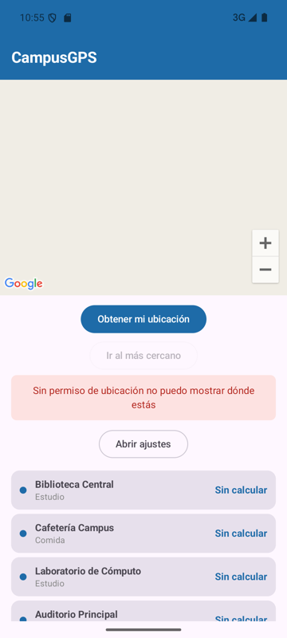
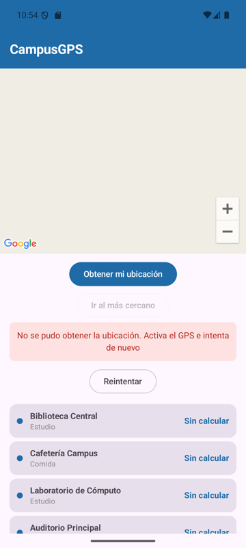
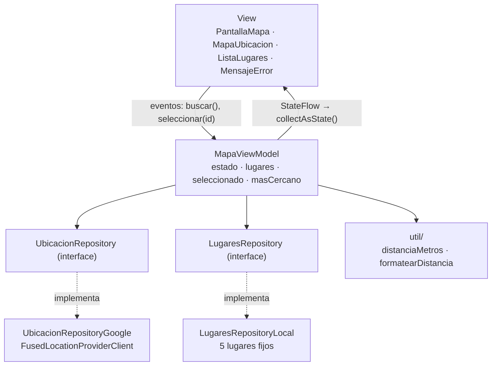

# CampusGPS

App Android en Kotlin que obtiene la ubicación del celular, la muestra en un mapa y dice qué lugar del campus está más cerca. Hay cinco puntos ficticios (biblioteca, cafetería, laboratorio, auditorio y estacionamiento) con su distancia en metros, ordenados del más cercano al más lejano.

Laboratorio 13 de Programación en Móviles (Tecsup) · Localización geográfica · Erick Gamarra · trabajo individual

| Dato | Valor |
|---|---|
| Paquete | `com.tecsup.campusgps` |
| Punto base | `-12.0464, -77.0428` (Lima) |
| Ubicación | `FusedLocationProviderClient.getCurrentLocation(...).await()` |
| Mapa | Maps Compose con clave guardada en `local.properties` |
| Patrón | MVVM + Repository (interfaces) |

## Capturas

| Permiso | Mapa con mi ubicación | Marcadores |
|---|---|---|
|  |  |  |

| Lista ordenada | Ir al más cercano | Error: sin permiso | Error: GPS apagado |
|---|---|---|---|
|  |  |  |  |

## Tecnologías

| Tema | Uso |
|---|---|
| Interfaz | Jetpack Compose + Material 3 (sin XML) |
| Ubicación | `play-services-location` 21.3.0 + `kotlinx-coroutines-play-services` para usar `await()` |
| Mapa | `maps-compose` 8.4.0 (`GoogleMap`, `Marker`, `rememberCameraPositionState`) |
| Estado | `ViewModel` + `StateFlow`, `lifecycle-viewmodel-compose` |
| Distancias | `Location.distanceBetween` en `util/` |

## Estructura de paquetes

```
com.tecsup.campusgps/
├── MainActivity.kt
├── model/
│   └── Modelos.kt                 Posicion, Lugar, LugarConDistancia, UbicacionUi, TipoError
├── data/
│   ├── UbicacionRepository.kt     interface (+ playServicesDisponible)
│   ├── UbicacionRepositoryGoogle.kt  implementación con Fused
│   ├── LugaresRepository.kt       interface
│   └── LugaresRepositoryLocal.kt  los 5 lugares
├── util/
│   ├── Distancia.kt               distanciaMetros()
│   └── Formato.kt                 formatearDistancia()
├── viewmodel/
│   ├── MapaViewModel.kt
│   └── CampusViewModelFactory.kt
└── ui/
    ├── PantallaMapa.kt
    ├── MapaUbicacion.kt
    ├── ListaLugares.kt
    ├── MensajeError.kt
    └── theme/
```

## Arquitectura MVVM + Repository



| Capa | Conoce a | No hace |
|---|---|---|
| View (`ui/`) | Solo a su ViewModel | No usa Repository ni Fused, no calcula distancias |
| ViewModel | Solo las interfaces de Repository | No recibe `Context` ni conoce Composables |
| Repository | Google Play Services | No expone clases de UI |
| `util/` | Funciones puras | No guarda estado |

## Cómo ejecutarlo

1. Crear una clave en Google Cloud con **Maps SDK for Android** habilitado y restringida al paquete `com.tecsup.campusgps` + SHA-1 de `./gradlew signingReport`.
2. Agregarla en `local.properties` (este archivo no se sube):
   ```
   MAPS_API_KEY=tu_clave
   ```
3. Usar un emulador **con Google Play** y ponerlo en el punto base: Extended controls → Location → `-12.0464`, `-77.0428` → Set location.
4. Ejecutar y pulsar **Obtener mi ubicación**.

## Pruebas de aceptación

| Prueba | Resultado | OK |
|---|---|---|
| Abrir la app por primera vez y pulsar el botón | Aparece el cuadro de permiso | ✅ |
| Aceptar el permiso | Se ve la ubicación y el marcador Estás aquí | ✅ |
| Negar el permiso | Mensaje de error con Abrir ajustes, la app no se cierra | ✅ |
| Ubicación en el punto base | Los 5 marcadores aparecen cerca de mi posición | ✅ |
| Tocar un marcador | Se ve el nombre y la categoría | ✅ |
| Lista de lugares | Ordenada de menor a mayor (88 m, 109 m, 172 m, 220 m, 266 m) | ✅ |
| Tocar una tarjeta | La cámara viaja al lugar (zoom 17) y la tarjeta queda resaltada | ✅ |
| Ir al más cercano | La cámara va al lugar verde; antes de buscar el botón está deshabilitado | ✅ |
| Cambiar la ubicación del emulador y buscar otra vez | Cambian distancias, orden y lugar verde (Estacionamiento Norte, 24 m) | ✅ |
| Ubicación apagada | Mensaje de GPS con Reintentar | ✅ |
| Rotar la pantalla | No se pierden la ubicación ni la lista (el ViewModel sobrevive) | ✅ |
| Revisar el repositorio | `git grep` no encuentra la clave y `local.properties` no está subido | ✅ |

## Para pensar

**1. ¿Por qué `FusedLocationProviderClient` está dentro del Repository y no en el ViewModel?**
Porque es un detalle de cómo se consigue la ubicación, y además necesita un `Context`. Si lo pongo en el ViewModel, este queda amarrado a Google Play Services y a Android, y ya no puedo probarlo con un repositorio falso. Con la interface `UbicacionRepository` el ViewModel solo pide "dame la posición" y no le importa si viene de Fused, de un GPS simulado o de un test.

**2. ¿Qué diferencia hay entre el permiso de ubicación y la clave de API de Maps? ¿Qué pasa si falta cada uno?**
El permiso lo da el usuario y autoriza a **mi app** a leer la ubicación del celular. La clave la da Google y autoriza a mi app a **usar el servicio de mapas**. Sin permiso, el mapa se ve igual pero no puedo saber dónde está el usuario (sale el mensaje con Abrir ajustes). Sin clave, la ubicación funciona y la lista calcula las distancias, pero el mapa sale en blanco y en Logcat aparece `Authorization failure`. Si falta el `<meta-data>` completo, la app se cierra al abrir el mapa.

**3. ¿Por qué la clave va en `local.properties` y no en el código? ¿Qué harías si se subiera a GitHub por error?**
Porque `local.properties` está en el `.gitignore`, así que la clave nunca entra al repositorio, y Gradle la pasa al Manifest con `manifestPlaceholders`. Si estuviera en el código, cualquiera que vea el repo podría usarla a mi nombre. Si se subiera por error, borrarla del commit no basta porque queda en el historial: hay que eliminar o regenerar la clave en Google Cloud, crear una nueva con las restricciones de paquete y SHA-1, y revisar el `.gitignore`.

**4. ¿Dónde calculas la distancia y por qué no en el Composable?**
En `util/Distancia.kt` (función pura) y la llamo desde `actualizarDistancias()` en el ViewModel, solo cuando llega la ubicación. Un Composable se puede recomponer muchas veces por segundo; si calculara ahí, repetiría el cálculo en cada recomposición y mezclaría lógica con dibujo. La pantalla solo pinta la lista que ya viene ordenada en el `StateFlow`.

**5. ¿Qué pasa con tu app si el usuario niega el permiso dos veces? ¿Cómo lo manejas?**
Desde Android 11, después de dos negativas el sistema ya no muestra el cuadro: el launcher responde "denegado" al instante. Como el resultado igual llega al callback, la app llama a `permisoDenegado()` y muestra el error con el botón **Abrir ajustes**, que abre la pantalla de la app con `Settings.ACTION_APPLICATION_DETAILS_SETTINGS` para que el usuario active la ubicación a mano. La app nunca se cierra.

## Fase 2 · Mejoras con IA (rama `mejora-ia-campusgps`)

Cuatro mejoras hechas con Gemini en Android Studio, revisadas y corregidas a mano. El detalle de cada prompt está en [PROMPTS.md](PROMPTS.md).

| Mejora | Capas |
|---|---|
| Filtro por categoría con chips | ViewModel + View |
| Radio de cercanía (100/200/500 m) con `Circle` | ViewModel + View |
| Seguimiento en vivo (`requestLocationUpdates` + `callbackFlow`) | Repository + ViewModel + View |
| Punto azul nativo, mapa oscuro y panel inferior deslizable | View |

## Commits de la Fase 1

| N | Mensaje |
|---|---|
| 1 | chore: importa proyecto base CampusGPS |
| 2 | chore: configura permisos y clave de Maps con local.properties |
| 3 | feat(ubicacion): pide permiso de ubicacion en tiempo de ejecucion |
| 4 | feat(mapa): muestra mapa con marcador de la ubicacion actual |
| 5 | feat(mapa): agrega marcadores de los lugares del campus |
| 6 | feat(distancia): calcula y ordena lugares por distancia |
| 7 | feat(ui): agrega lista de lugares y seleccion en el mapa |
| 8 | feat(ui): resalta y navega al lugar mas cercano |
| 9 | feat(errores): maneja permiso denegado, GPS apagado y sin Play Services |
| 10 | docs: agrega README con estructura y capturas |
