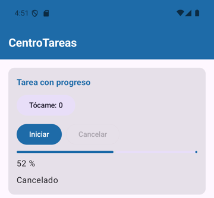
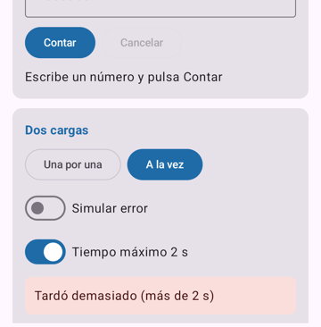
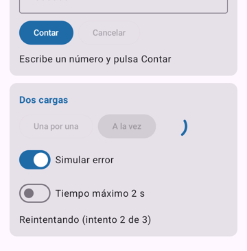
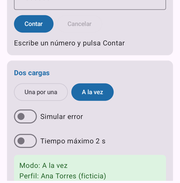

# PROMPTS.md · Fase 2 con IA

Usé Gemini dentro de Android Studio (panel Agent, Gemini 3.6 Flash) en la rama `mejora-ia-centrotareas`. Para cada mejora abrí un chat nuevo y le escribí un prompt bien detallado: qué archivo tocar, qué nombres usar y qué no hacer (nada de GlobalScope, runBlocking ni Thread.sleep). Después de cada respuesta revisé los cambios con `git diff`, lo probé en el emulador y recién ahí hice el commit.

## Resumen

| Mejora | Qué cambió | Commit |
|---|---|---|
| 1. Progreso desde el Repository | Repository + ViewModel | `feat(ia): mueve el progreso de la tarea al Repository como Flow` |
| 2. Tiempo máximo | ViewModel + pantalla | `feat(ia): agrega tiempo maximo de 2 s a las cargas con withTimeout` |
| 3. Reintento automático | ViewModel + pantalla | `feat(ia): reintenta las cargas hasta 3 veces con espera creciente` |

| Progreso con Flow | Tiempo máximo | Reintentando | Reintento con éxito |
|---|---|---|---|
|  |  |  |  |

## Tabla de prompts

| Prompt que escribí | Qué respondió Gemini | Qué cambié o descarté | Por qué |
|---|---|---|---|
| Prompt 1 (progreso desde el Repository), completo abajo | Agregó `tareaConProgreso(): Flow<Float>` en la interface, la hizo con `flow { emit() }.flowOn(Dispatchers.Default)` y en el ViewModel cambió el `for` por `collect`. | **Descarté su versión del ViewModel.** Trabajó con una copia vieja del archivo y me borró todo el Paso 7 (simularError, el try/catch y Reintentar). Restauré el archivo del último commit y apliqué a mano solo el cambio del `collect`. | Si aceptaba todo, perdía el manejo de errores que ya funcionaba. Por eso reviso el diff completo y no solo el resumen que da Gemini. |
| Prompt 2 (tiempo máximo), completo abajo | Agregó el interruptor, `withTimeout(2000)` y un `catch` de `TimeoutCancellationException` antes del de `CancellationException`. | Nada, lo dejé igual. Esta vez le pedí que leyera el archivo desde el disco y no borró nada. | El orden de los `catch` está bien: `TimeoutCancellationException` hereda de `CancellationException`, así que si va después nunca se atrapa. |
| Prompt 3 (reintento automático), completo abajo | Hizo `conReintentos()` con 3 intentos, espera de 500 y 1000 ms, relanza la `CancellationException` y muestra "Reintentando (intento X de 3)". | Nada. Lo probé: con el error activado salió el intento 2, y al quitar el error el siguiente intento terminó bien. Con el error siempre activo, a los 3 intentos sale el recuadro rojo. | Cumple las reglas: no se traga la cancelación y la espera usa `delay`, que no bloquea. |
| Prompt 4 (primos con porcentaje), completo abajo | No llegó a responder: salió `RESOURCE_EXHAUSTED`, se acabó la cuota gratuita de Gemini. | Lo detuve. No cambió ningún archivo (`git status` limpio). | Con 3 mejoras ya se cumple el mínimo de la guía, así que no la hice a mano para no mezclar código sin IA en esta fase. |

## Prompts completos (tal como los escribí en Gemini)

### Prompt 1 · Progreso desde el Repository

```text
Proyecto Android Kotlin + Jetpack Compose con MVVM + Repository (paquete com.tecsup.centrotareas). Quiero mover la TAREA CON PROGRESO al Repository. Reglas estrictas: 1) En data/TareasRepository.kt agrega a la interface fun tareaConProgreso(): Flow<Float>. 2) En data/TareasRepositoryLocal.kt impleméntala con flow { for (i in 1..100) { delay(40); emit(i / 100f) } }.flowOn(Dispatchers.Default). 3) En viewmodel/TareasViewModel.kt cambia SOLO el cuerpo de tareaLarga(): dentro del mismo viewModelScope.launch con try/finally que ya existe, reemplaza el withContext con el for por repo.tareaConProgreso().collect { _progreso.value = it }. Mantén _corriendo, trabajo (Job), cancelar(), los Log.d("HILO") de Antes y Despues y el mensaje Terminó. Borra el Log.d de Dentro porque ahora el trabajo lo hace el Repository. 4) NO toques la pantalla, NO uses GlobalScope, runBlocking ni Thread.sleep, NO uses Context en el ViewModel. Edita los archivos directamente.
```

### Prompt 2 · Tiempo máximo

```text
Proyecto Android Kotlin + Jetpack Compose con MVVM + Repository (paquete com.tecsup.centrotareas). Lee primero el archivo actual viewmodel/TareasViewModel.kt desde el disco: ya tiene simularError, cargarUnaPorUna(), cargarALaVez(), reintentar() y una función privada cargar(modo, bloque) con try/catch. NO borres nada de eso. Quiero agregar un TIEMPO MÁXIMO a las cargas. Reglas estrictas: 1) En el ViewModel agrega private val _limiteActivo = MutableStateFlow(false), val limiteActivo: StateFlow<Boolean> y fun cambiarLimite(valor: Boolean). 2) Dentro de la función privada cargar(), envuelve la llamada val (perfil, pedidos) = bloque() con withTimeout(2000) SOLO cuando _limiteActivo.value sea true (si es false, llama a bloque() normal). 3) En el try/catch agrega un catch (e: TimeoutCancellationException) ANTES del catch de CancellationException que ponga _carga.value = CargaUi.Error("Tardó demasiado (más de 2 s)"). Importante: TimeoutCancellationException hereda de CancellationException, por eso debe ir primero. 4) En ui/PantallaTareas.kt, dentro de la tarjeta Dos cargas y debajo del Switch Simular error, agrega otro Row con un Switch y el texto Tiempo máximo 2 s que use vm.limiteActivo y vm.cambiarLimite. NO uses GlobalScope, runBlocking ni Thread.sleep, NO uses Context en el ViewModel. Edita los archivos directamente.
```

### Prompt 3 · Reintento automático

```text
Proyecto Android Kotlin + Jetpack Compose con MVVM + Repository (paquete com.tecsup.centrotareas). Lee primero desde el disco los archivos actuales viewmodel/TareasViewModel.kt y ui/PantallaTareas.kt y NO borres nada de lo que ya existe (simularError, limiteActivo, withTimeout, cargar(), reintentar(), Flow de progreso). Quiero un REINTENTO AUTOMÁTICO en las cargas. Reglas estrictas: 1) En el ViewModel agrega private val _intento = MutableStateFlow(0) y val intento: StateFlow<Int>. 2) Crea una función privada suspend fun <T> conReintentos(veces: Int = 3, bloque: suspend () -> T): T que intente hasta 3 veces; antes de cada intento pone _intento.value = numeroDeIntento; si falla con una excepción que NO sea CancellationException espera delay(500L * numeroDeIntento) (espera creciente: 500, 1000 ms) y vuelve a intentar; si es CancellationException la relanza de inmediato con throw e; si falla las 3 veces lanza la última excepción. 3) En cargar() usa conReintentos { bloque() } en lugar de bloque() (dentro del withTimeout si está activo). 4) En ui/PantallaTareas.kt, cuando carga sea CargaUi.Cargando y intento > 1, muestra el texto Reintentando (intento X de 3) en lugar de Cargando.... NO uses GlobalScope, runBlocking ni Thread.sleep, NO uses Context en el ViewModel. Edita los archivos directamente.
```

### Prompt 4 · Primos con porcentaje (no se completó)

```text
Proyecto Android Kotlin + Jetpack Compose con MVVM + Repository (paquete com.tecsup.centrotareas). Lee primero desde el disco data/TareasRepository.kt, data/TareasRepositoryLocal.kt, viewmodel/TareasViewModel.kt y ui/PantallaTareas.kt y NO borres nada de lo que ya existe. Quiero mostrar el PORCENTAJE DEL CÁLCULO DE PRIMOS mientras avanza. Reglas estrictas: 1) En la interface TareasRepository cambia la firma a suspend fun contarPrimos(hasta: Int, alAvanzar: (Float) -> Unit = {}): Int. 2) En TareasRepositoryLocal, dentro del for que ya existe con ensureActive(), llama a alAvanzar(n.toFloat() / hasta) solo cada 1 % (calcula val paso = maxOf(1, hasta / 100) y avisa cuando n % paso == 0), y al final alAvanzar(1f). Mantén withContext(Dispatchers.Default). 3) En TareasViewModel agrega private val _avancePrimos = MutableStateFlow(0f) y val avancePrimos: StateFlow<Float>; en contar() ponlo en 0f al empezar y pasa { _avancePrimos.value = it } como alAvanzar (MutableStateFlow es seguro de actualizar desde otro hilo). No cambies el try/catch de CancellationException. 4) En ui/PantallaTareas.kt, en la tarjeta Contar números primos, cuando primos sea PrimosUi.Calculando muestra un LinearProgressIndicator con avancePrimos y el texto Calculando... X % en lugar de Calculando.... NO uses GlobalScope, runBlocking ni Thread.sleep, NO uses Context en el ViewModel. Edita los archivos directamente.
```

## Cómo comprobé que no se rompieron las reglas

- `git grep` no encuentra GlobalScope, runBlocking ni Thread.sleep.
- Todos los `catch` dejan pasar la `CancellationException` (con `throw e`).
- El ViewModel no recibe `Context` y la pantalla no lanza corrutinas.
- Probé en el emulador: la barra con Flow se cancela igual que antes, el tiempo máximo corta a los 2 s y el reintento muestra el intento 2 de 3.

## Lo que aprendí

Gemini rinde mejor si le dices qué archivo tocar y qué no hacer. Pero en el primer prompt me borró el Paso 7 entero porque usó una copia vieja del archivo. Desde ahí empecé cada prompt con "lee primero el archivo desde el disco y no borres nada", y ya no volvió a pasar. Igual reviso siempre el `git diff` antes de hacer commit.
