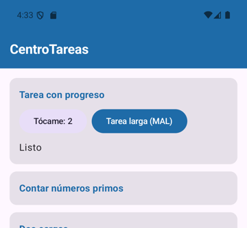
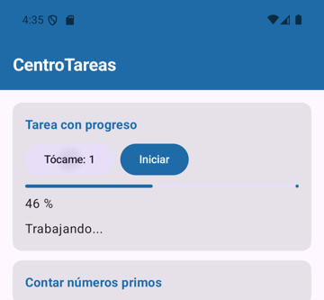
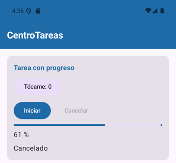
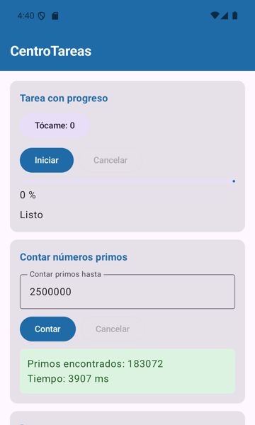
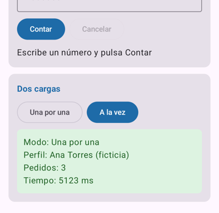
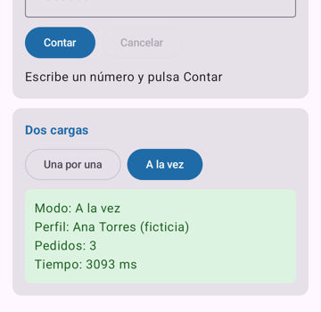
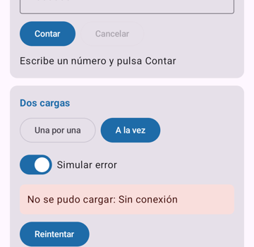

# CentroTareas

App Android en Kotlin para practicar hilos y corrutinas. Tiene una tarea con barra de progreso, un cálculo pesado (contar números primos) y dos cargas de datos simuladas. La idea es que la pantalla nunca se congele.

Laboratorio 14 de Programación en Móviles (Tecsup) · Hilos en Android · Erick Gamarra · trabajo individual

## Capturas

| Pantalla congelada (Paso 1) | Tarea con progreso | Cancelada |
|---|---|---|
|  |  |  |

| Primos | Una por una | A la vez | Error |
|---|---|---|---|
|  |  |  |  |

## Estructura de paquetes

```
com.tecsup.centrotareas/
├── MainActivity.kt
├── model/
│   └── Estados.kt                 PrimosUi, CargaUi
├── data/
│   ├── TareasRepository.kt        interface
│   └── TareasRepositoryLocal.kt   cargas simuladas y contarPrimos
├── viewmodel/
│   ├── TareasViewModel.kt
│   └── TareasViewModelFactory.kt
└── ui/
    ├── PantallaTareas.kt          las tres tarjetas
    └── theme/
```

## Arquitectura MVVM + Repository

```
 View (PantallaTareas)
    | eventos: botones              ^ collectAsState()
    v                               |
 ViewModel (TareasViewModel) --- StateFlow --->
    | viewModelScope.launch { ... }
    v
 TareasRepository (interface) ---> TareasRepositoryLocal
                                    (cargas simuladas y contar primos)
```

- La pantalla solo muestra el estado y avisa los toques. No lanza corrutinas.
- El ViewModel lanza todo con `viewModelScope` y no recibe `Context`.
- El Repository hace el trabajo pesado: los primos van en `Dispatchers.Default` y las cargas usan `delay`, que no bloquea.

## Observación del Paso 1

Al tocar **Tarea larga (MAL)** la pantalla se queda congelada 4 segundos: el botón Tócame no suma y nada responde. Cuando termina, el texto pasa directo de Listo a Terminó y los toques que hice se procesan de golpe.

El texto **Trabajando...** nunca se ve porque `Thread.sleep(4000)` corre en el hilo principal, que es el mismo que dibuja la pantalla. Cambio el mensaje, pero el hilo se duerme antes de poder redibujar, y cuando despierta ya lo cambié a Terminó.

Si la espera fuera de 10 segundos, Android mostraría el aviso **"La aplicación no responde" (ANR)**, con la opción de cerrarla o esperar. Ese aviso sale cuando el hilo principal no atiende un toque en unos 5 segundos.


## Pruebas de aceptación

| Prueba | Resultado | OK |
|---|---|---|
| Tocar Tócame mientras trabaja la tarea | El contador sigue sumando | ✅ |
| Logcat con filtro HILO | `Antes: main`, `Dentro: DefaultDispatcher-worker-2`, `Despues: main` | ✅ |
| Iniciar la tarea con progreso | La barra va de 0 a 100 % en unos 4 s | ✅ |
| Cancelar a mitad | Se queda en 61 %, dice Cancelado y se puede volver a iniciar | ✅ |
| Pulsar Iniciar dos veces | El botón se deshabilita, no se lanzan dos tareas | ✅ |
| Primos hasta 1000 | 168 (también 25, 1229, 9592 y 41 538 para 100, 10 000, 100 000 y 500 000) | ✅ |
| Primos con N grande | Con 2 500 000 tarda unos 4 s, la pantalla responde y Cancelar funciona | ✅ |
| Una por una | 5123 ms | ✅ |
| A la vez | 3093 ms | ✅ |
| Error simulado + Reintentar | Recuadro rojo; sin el interruptor, Reintentar da éxito | ✅ |
| Rotar durante la tarea | La tarea sigue (67 % → 100 %), no se reinicia | ✅ |
| `git grep` de GlobalScope, runBlocking y Thread.sleep | No encuentra nada | ✅ |

El valor por defecto de primos lo dejé en 2 500 000 porque en mi emulador 500 000 tardaba menos de 1 s y 5 000 000 tardaba 9 s.

## Para pensar

**1. ¿Por qué no se veía Trabajando... en el Paso 1?**
Porque `Thread.sleep` bloqueaba el hilo principal, que es el que dibuja. Cambié el texto, pero la pantalla no alcanzó a redibujarse antes de dormirse, y al despertar ya había cambiado a Terminó.

**2. ¿Qué diferencia hay entre Thread.sleep y delay?**
`Thread.sleep` duerme el hilo completo y nadie más lo puede usar. `delay` solo suspende la corrutina: el hilo queda libre para hacer otras cosas (dibujar, atender toques) y la corrutina sigue cuando pasa el tiempo. Además, `delay` se puede cancelar.

**3. ¿Por qué Dispatchers.Default para los primos y Dispatchers.IO para la red?**
Contar primos usa mucho procesador, y `Default` tiene tantos hilos como núcleos tiene el celular. La red o el disco pasan casi todo el tiempo esperando, así que `IO` permite muchos más hilos esperando a la vez sin gastar CPU.

**4. ¿Qué pasa con la corrutina si el usuario cierra la pantalla? ¿Qué papel cumple viewModelScope?**
`viewModelScope` está atado al ViewModel. Si solo se gira la pantalla, el ViewModel sigue vivo y la tarea continúa (lo probé). Si se cierra la pantalla de verdad, el ViewModel se destruye y `viewModelScope` cancela todas sus corrutinas solo, así no quedan tareas sueltas gastando batería.

**5. ¿Por qué async tarda 3 s y no 5 s? ¿Qué pasa si una de las dos cargas falla?**
Porque las dos cargas arrancan al mismo tiempo y solo espero a la más lenta (3 s). Una por una se suman (2 s + 3 s). Si una falla dentro de `coroutineScope`, se cancela la otra y el error sube hasta mi `try/catch`, que muestra el recuadro rojo con Reintentar.

## Commits de la Fase 1

| N | Mensaje |
|---|---|
| 1 | chore: importa proyecto base CentroTareas |
| 2 | feat(hilos): provoca el congelamiento con Thread.sleep en el hilo principal |
| 3 | fix(hilos): mueve la tarea larga a una corrutina con withContext |
| 4 | feat(progreso): agrega barra de progreso con StateFlow |
| 5 | feat(cancelar): permite cancelar la tarea con Job |
| 6 | feat(primos): cuenta primos en Dispatchers.Default con cancelacion |
| 7 | feat(carga): compara carga secuencial y en paralelo con async |
| 8 | feat(errores): maneja errores de carga y agrega reintento |
| 9 | docs: agrega README con observaciones y capturas |
