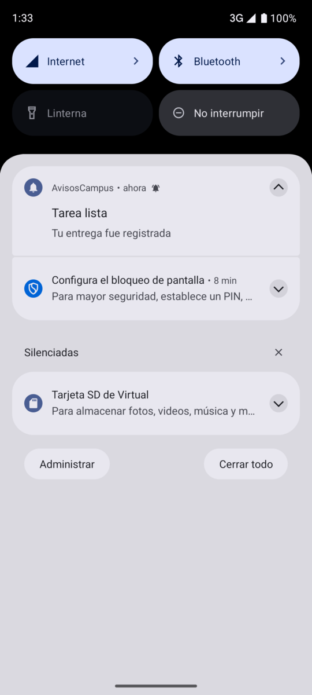
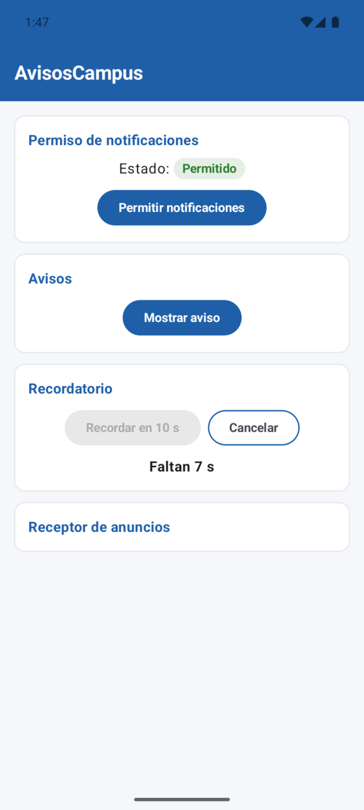
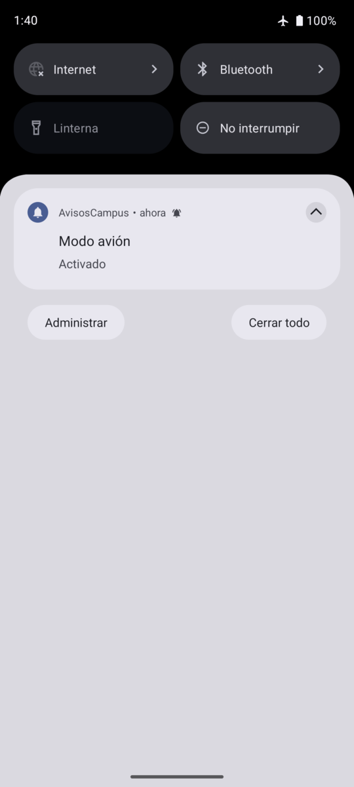
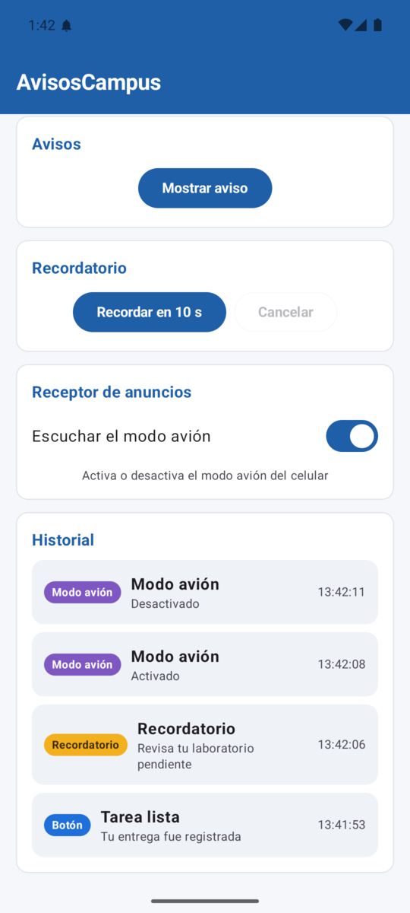
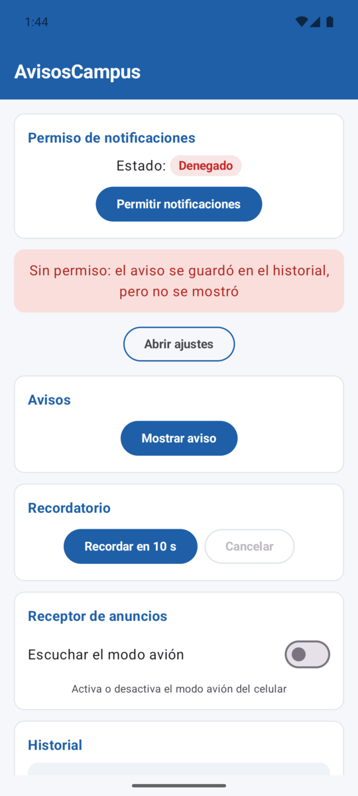
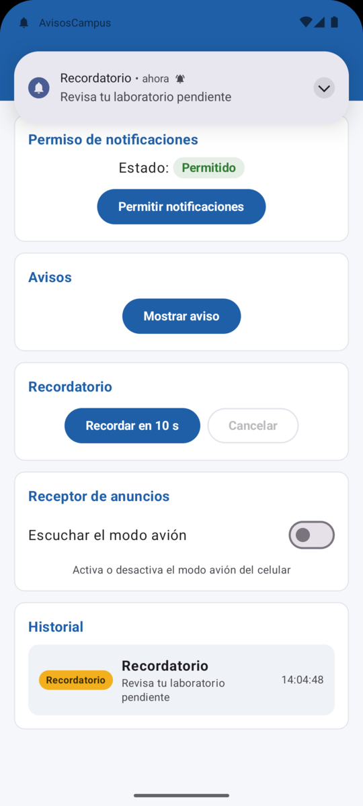
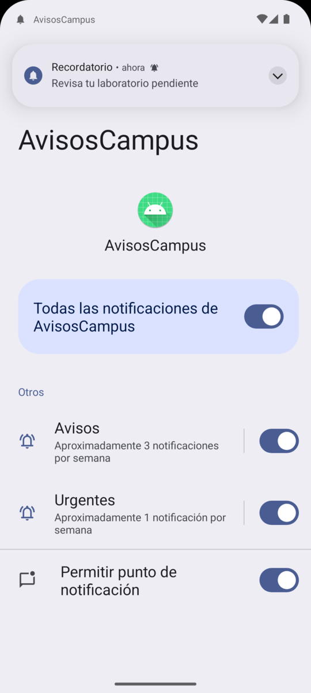
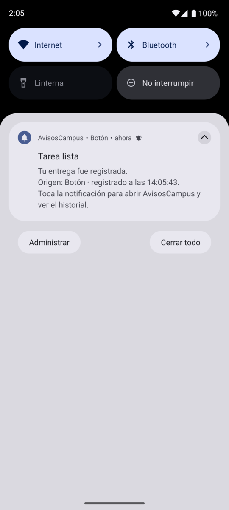
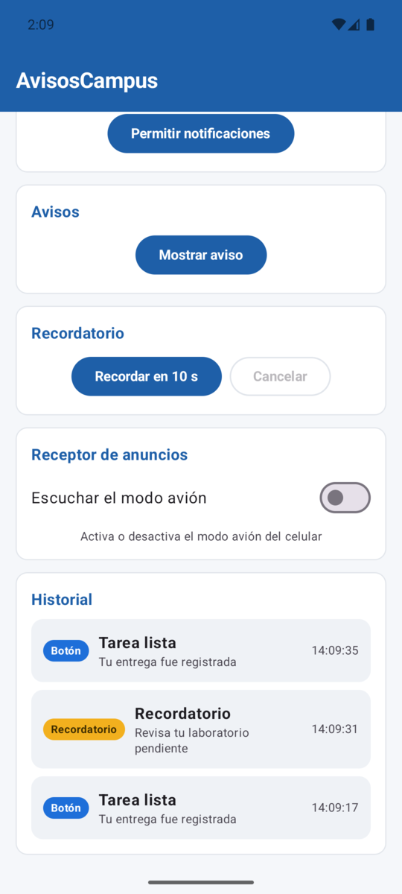

# AvisosCampus

App Android en Kotlin y Jetpack Compose que muestra notificaciones locales y escucha lo que pasa en el celular. Con un botón muestra un aviso, con otro programa un recordatorio que llega a los 10 segundos, y puede avisar cuando se activa o desactiva el modo avión. Todo queda anotado en un historial.

Laboratorio 15 de Programación en Móviles (Tecsup) · Notificaciones en Android · Erick Gamarra · trabajo individual

## Capturas

| Notificación en el panel | Recordatorio | Modo avión |
|---|---|---|
|  |  |  |

| Historial | Permiso denegado |
|---|---|
|  |  |

## Estructura de paquetes

```
com.tecsup.avisoscampus/
├── AvisosApp.kt                    Application: crea el canal
├── MainActivity.kt
├── model/
│   └── Modelos.kt                  Aviso, Origen, PermisoUi
├── data/
│   └── AvisosRepository.kt         interface + AvisosRepositoryMemoria
├── notificacion/
│   └── Notificador.kt              canal, permiso y mostrar
├── receiver/
│   └── ModoAvionReceiver.kt        escucha ACTION_AIRPLANE_MODE_CHANGED
├── viewmodel/
│   ├── AvisosViewModel.kt
│   └── AvisosViewModelFactory.kt
└── ui/
    ├── PantallaAvisos.kt           las tarjetas, el permiso y el receptor
    ├── HistorialAvisos.kt          lista de avisos
    └── theme/
```

## Arquitectura MVVM + Repository

```
 View (PantallaAvisos)
    | eventos: botones, switch          ^ collectAsState()
    v                                   |
 ViewModel (AvisosViewModel) --- StateFlow (avisos, permiso, faltan, mensaje) --->
    | registra el aviso       | emite: eventos (SharedFlow<Aviso>)
    v                         v
 AvisosRepository (interface)     La View recibe el evento y llama a
   -> AvisosRepositoryMemoria     Notificador.mostrar(context, aviso)
```

- El ViewModel decide qué avisar, lo anota en el Repository y emite un evento. No usa `Context`, `NotificationManager` ni `BroadcastReceiver`.
- La pantalla, que sí tiene `Context`, recibe el evento y llama al `Notificador`. Si `mostrar` devuelve `false` (sin permiso), avisa al ViewModel.
- El receptor del modo avión se registra en un `DisposableEffect` solo mientras el switch está activo y se quita en `onDispose`.

## Pruebas de aceptación

Probadas en el emulador Pixel 8 con Android 15 (API 35).

| Prueba | Resultado | OK |
|---|---|---|
| Ajustes → Apps → AvisosCampus → Notificaciones | Aparece el canal Avisos | ✅ |
| Pulsar Permitir notificaciones | Sale el cuadro de Android y la etiqueta cambia a Permitido o Denegado | ✅ |
| Pulsar Mostrar aviso | Aparece la notificación Tarea lista | ✅ |
| Pulsar Mostrar aviso dos veces | Dos notificaciones distintas (id 1 y 2) | ✅ |
| Tocar la notificación | Se abre la app (también con el proceso cerrado) y la notificación desaparece | ✅ |
| Recordar en 10 s | Cuenta regresiva y aviso Recordatorio al llegar a 0 | ✅ |
| Recordar y minimizar la app | El aviso llega igual | ✅ |
| Recordar y cancelar | No llega ningún aviso | ✅ |
| Switch activado y cambiar el modo avión | Aviso Activado y luego Desactivado | ✅ |
| Switch desactivado y cambiar el modo avión | No hay aviso | ✅ |
| Permiso denegado y Mostrar aviso | Mensaje de error, aviso en el historial y la app no se cierra | ✅ |
| Rotar la pantalla durante el recordatorio | La cuenta sigue (Faltan 6 s en horizontal) y el aviso llega | ✅ |
| Revisar el código | `grep` no encuentra Context ni NotificationManager en `viewmodel/`; el único `registerReceiver` tiene su `unregisterReceiver` en `onDispose` | ✅ |

Para el modo avión usé `adb shell cmd connectivity airplane-mode enable` y `disable`, que mandan el mismo anuncio que el ícono del panel rápido.

## Para pensar

**1. ¿Por qué una notificación necesita un canal y un permiso? ¿Qué pasa si falta cada uno?**
El canal (Android 8+) agrupa las notificaciones por tipo y le deja al usuario decidir la importancia, el sonido o apagar solo ese tipo. Si falta el canal, `notify` no muestra nada y en Logcat sale un error de canal no encontrado. El permiso `POST_NOTIFICATIONS` (Android 13+) es para que el usuario decida si la app puede molestarlo. Si falta, tampoco se muestra nada; por eso `mostrar` lo revisa antes y devuelve `false`.

**2. ¿Por qué el ViewModel emite un evento y no muestra la notificación él mismo?**
Para mostrarla hace falta un `Context`, y el ViewModel vive más que la Activity: si guardara uno, al rotar quedaría apuntando a una pantalla destruida y se filtraría memoria. Con el evento, el ViewModel solo decide y anota, y se puede probar sin Android. La pantalla, que sí tiene `Context`, hace la parte del sistema.

**3. ¿Qué pasa si usas el mismo id en dos notificaciones?**
La segunda reemplaza a la primera y en el panel queda una sola. Por eso uso `aviso.id`, que el Repository aumenta en cada aviso, y al pulsar dos veces salen dos notificaciones.

**4. ¿Por qué onReceive debe ser corto y por qué hay que quitar el receptor al salir?**
`onReceive` corre en el hilo principal; si tarda unos 10 segundos Android da un ANR. Por eso solo lee el estado y llama a la función. El receptor hay que quitarlo porque guarda una referencia a la pantalla y al ViewModel: si queda registrado, se filtra memoria y sigue recibiendo anuncios aunque ya nadie los use.

**5. ¿En qué casos usarías una notificación local y en cuáles una push de Firebase?**
Local cuando el aviso nace en el propio celular: un recordatorio, una tarea que terminó, un cambio del sistema como el modo avión. Push cuando la información viene de un servidor y la app puede estar cerrada: un mensaje nuevo, una nota publicada o un aviso que el docente manda a todo el curso.

## Fase 2 · Mejoras (rama mejora-ia-avisoscampus)

| Mejora | Qué hace | Capas que cambian |
|---|---|---|
| Dos canales | El recordatorio sale por el canal Urgentes (`IMPORTANCE_HIGH`) y aparece emergente | Notificador + modelo + ViewModel |
| Texto largo | Al expandir la notificación se ve el texto completo con `BigTextStyle` | Notificador |
| Historial persistente | El historial se guarda con DataStore y sigue ahí al reabrir la app | Repository + AvisosApp + fábrica del ViewModel |

| Notificación urgente | Dos canales | Texto largo | Historial guardado |
|---|---|---|---|
|  |  |  |  |

Los prompts, lo que cambié y por qué están en [PROMPTS.md](PROMPTS.md).

## Commits de la Fase 1

| N | Mensaje |
|---|---|
| 1 | chore: importa proyecto base AvisosCampus |
| 2 | feat(notificacion): crea el canal Avisos en la clase Application |
| 3 | feat(permiso): pide POST_NOTIFICATIONS y muestra su estado |
| 4 | feat(notificacion): muestra la notificacion con NotificationCompat |
| 5 | feat(notificacion): abre la app al tocar con PendingIntent |
| 6 | feat(recordatorio): cuenta regresiva con corrutina y cancelacion |
| 7 | feat(receptor): escucha el modo avion con BroadcastReceiver |
| 8 | feat(ui): agrega historial de avisos |
| 9 | feat(errores): maneja el permiso de notificaciones denegado |
| 10 | docs: agrega README con estructura y capturas |

## Commits de la Fase 2

| N | Mensaje |
|---|---|
| 1 | feat(canales): agrega el canal Urgentes con IMPORTANCE_HIGH para el recordatorio |
| 2 | feat(notificacion): muestra el texto completo al expandir con BigTextStyle |
| 3 | feat(historial): guarda el historial con DataStore para que no se pierda al cerrar |
| 4 | docs: agrega PROMPTS.md y las mejoras de la Fase 2 al README |
